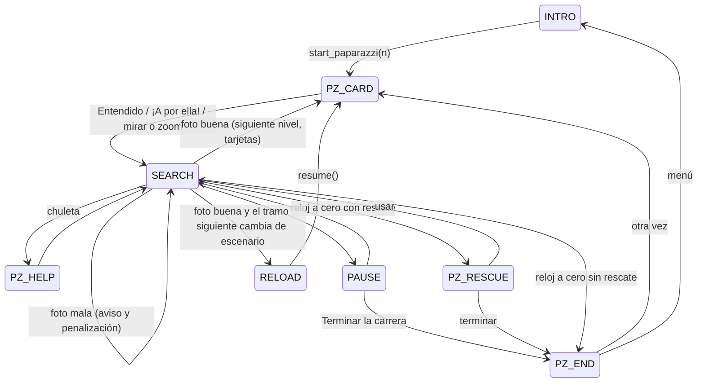

# 29 · Modo Paparazzi: supervivencia de encuadres con cámara ideal

> **Estado: ✅ Hecho (E0–E10, 25/26-11-2026), publicado para probarlo a fondo en la 0.7.0-alpha (solo GitHub) y en GitHub e itch en la 0.7.1-alpha (26-11-2026). Falta la validación del usuario y E11, opcional.** Rediseñado tras la primera prueba a mano: todo en el parque grande, el tramo 1 con «un plano cualquiera» y el enganche voluntario (decisiones 10–14 y §9.1). El estado y las diferencias con el plan de cada etapa están en el §20; la calibración, en el §22. Lo que sigue es la especificación con la que se hizo, con sus incógnitas ya despejadas (§23).

## Decisiones del usuario (25-11-2026)

1. El modo se llama **«Paparazzi»** (igual en inglés). Nada de «Wally» en el juego. (El modo Historia aplazado de [10](10_MODO_HISTORIA_DUAL_LEGADO.md) se titula «El legado del paparazzi»: si algún día se hace, se le cambia el nombre allí.)
2. **Cámara ideal:** enfoca, expone y estabiliza perfecto. El jugador solo busca, encuadra con el zoom y dispara. Lo que se pide son **encuadres** (planos y modificadores), no técnica.
3. **Tutoriales suficientes para cualquiera**, aunque no haya jugado a ningún otro modo.
4. **Supervivencia con muchos niveles de dificultad creciente** (el usuario los llamó «fases»; aquí, *niveles*), **infinitos y procedurales**, con **hitos cada 10 niveles** que se consolidan y permiten empezar desde ellos.
5. **Objetivo del jugador: avanzar muchos niveles.**
6. Los objetivos nuevos que no existían en el arcade **se añaden también al arcade** como niveles nuevos (§17).
7. **Interfaz reducida** propia del modo.
8. **Cuantas más ayudas, mejor.**
9. El enganche lo decide quien planifica: **siempre activo, nunca se quita** (justificación en §7.1). **Cambiado tras la prueba a mano (punto 10).**

### Tras la primera prueba a mano (25-11-2026, con E5 hecha)

10. **El enganche es voluntario:** «se me va a otros personajes muchas veces». Ya no se engancha solo al hacer zoom. Solo con clic sobre la persona o `{pz_enganchar}`, y se suelta igual. Hecho: `auto_lock()` quitado; `lock_delay` y la tarjeta `enganche_lento` del tramo 7 quedan sin uso hasta el rediseño.
11. **El parque grande es lo que engancha** («ese es el verdadero busca a Wally»). **Hay que invertir el orden:** los primeros niveles, en el parque grande y pidiendo a la persona con **un plano cualquiera**, sin explicar los planos. Lo difícil llega después: ajustar el plano. **Pendiente de rediseñar** la curva del §9 y las etapas del §20 (E7 pasa a ir antes que el resto).
12. **En el parque grande, cada nivel empieza con la cámara bajada** (andando). Hecho en `begin_level()`.
13. **Arcade, bloque 7:** sin saber de planos de cine «es difícil saber qué quiere»: **hace falta una guía** (el pictograma del plano, la etiqueta en vivo, y en el motivo de rechazo dónde cortar con palabras llanas y hacia dónde mover el zoom). Las ayudas de Paparazzi sobre cada plano sí se entienden.
14. **Fallo corregido:** en los niveles que esconden gente («nadie más en el encuadre») el perro se quedaba paseando solo si se escondía a su dueño. Ahora se esconde con él (`dog.gd`).

---

## 0. Cómo usar este documento

### 0.1 Antes de escribir código

Lee, por este orden: `AGENTS.md` (invariantes del §3, sobre todo 3.4 y 3.5), este documento entero, [ARQUITECTURA](../ARQUITECTURA.md), [TESTS_Y_VERIFICACION](../TESTS_Y_VERIFICACION.md) §1 y §4.3, [21](21_ARCADE_CONDICIONES_TLR.md) (arcade y condiciones), [22](22_MENU_TUTORIAL_MANDO.md) (menú, tutorial y mando) y [25](25_TEXTOS_Y_MULTIIDIOMA.md) §4.3 (vocabulario del inglés).

### 0.2 Reglas que no se rompen al implementar esto

- **No cambian las invariantes:** 21 viandantes en el parque clásico y 45 en el grande; carriles y `LANE_LINES` intactos; el ritmo de los caminantes (`walk_pace`) **nunca pasa de 1,0** (las velocidades de `AGENTS.md` §3.2 son invariantes).
- **Ningún texto en el código.** Todo va a `textos/es/*.md` y `textos/en/*.md`, en los dos idiomas a la vez, y se regenera con `python3 tools/textos.py`. **Mayúscula tras dos puntos.** Los controles se escriben como `{control}`, nunca como tecla.
- **Cada texto nuevo se mira en captura** y pasa `tools/check_text_fit.gd`, en español y en inglés.
- **Sin emojis ni símbolos raros en la interfaz:** la fuente del navegador no los tiene (ver `clock_text()`). Los iconos se dibujan con `_draw()`.
- **Las pruebas con pantalla llevan `--disable-vsync` y nunca `--headless`.** Ninguna prueba escribe en los ficheros del jugador (progreso, insignias, álbum): cada una apunta a su copia.
- **El juez es determinista:** la misma evidencia da siempre el mismo veredicto.
- Cada etapa (§20) termina con `~/bin/godot-4-fp --path . -- --smoke-test` en verde y sus pruebas en verde. Es un buen punto para un commit si el usuario lo ha pedido.
- **Al terminar, la documentación se actualiza** (§21). Es obligatorio en este proyecto.

### 0.3 Vocabulario

| Término | Significado |
|---|---|
| **Carrera** | Una partida de supervivencia: empieza en un nivel y acaba cuando el reloj llega a cero (o el jugador la termina). |
| **Nivel** | Un encargo: una foto pedida (en los hitos, un reportaje de tres). Numerados 1, 2, 3… sin fin. |
| **Tramo** | Diez niveles seguidos (1–10, 11–20…). Cada tramo tiene escenario, luz y novedades propios. |
| **Hito** | El último nivel de cada tramo (10, 20, 30…). Superarlo lo **consolida**: las siguientes carreras pueden empezar en el nivel siguiente (11, 21, 31…). |
| **Reloj** | El tiempo que le queda al jugador. Corre mientras busca; cada foto buena lo recarga. |
| **Encargo** | Qué foto se pide: **persona** + **plano** + **modificadores**. |
| **Plano** | El tamaño del encuadre según por dónde corta el borde inferior (§4). |
| **Modificador** | Una exigencia extra: sola, acompañada, de frente, con su perro… (§5). |
| **Protagonista** | La persona de la que es la foto (§6.4). |
| **Enganche** | La cámara sigue a una persona sola (§7). |
| **Auto-encuadre** | Con el enganche, la cámara coloca a la persona en el encuadre según el plano pedido (§7.4). |
| **Semáforo** | Las esquinas del visor: blancas, ámbar o verdes según la foto valdría o no (§8). |
| **Comodín** | Ayuda que se gasta: Congelar, Otro encargo, Rescate (§3.5). |

---

## 1. El modo en una página

El jugador elige **Paparazzi** en el menú y el nivel de partida (el 1 o un hito consolidado). Aparece la **ficha**: una miniatura 3D girando de la persona buscada, su ropa con muestras de color y la foto que quieren («Plano medio · Sola»). El reloj está parado mientras la lee.

Al cerrarla, el parque se mueve y el reloj corre. El jugador mira alrededor, encuentra a la persona y apunta. Al acercar el zoom, la cámara **se le engancha**: la sigue y la encuadra. Debajo, una etiqueta dice qué plano está haciendo («Plano americano»). Cuando todo cumple, **las esquinas se ponen verdes**. Dispara.

- **Foto buena:** se queda como una polaroid en una esquina, el reloj gana segundos y entra la ficha del siguiente nivel. Sin pantallas de resultado.
- **Foto mala:** un aviso de una línea dice por qué («Es un plano medio y te pedían un primer plano: Más zoom»), el reloj pierde unos segundos y se sigue buscando.

Cada diez niveles hay un **hito** (un pequeño reportaje de tres fotos a la misma persona). Al superarlo queda consolidado. Cuando el reloj llega a cero se ofrece el **rescate** (una vez por carrera). Después, la pantalla final: nivel alcanzado, récord, hoja de contactos y «Otra vez desde el nivel 31».

**La dificultad crece en la búsqueda, no en la puntería:** gente vestida casi igual, menos pistas, menos tiempo de bonificación, más exigencias por foto, noche, el parque grande. La cámara sigue ayudando siempre a apuntar.

El juego **enseña el lenguaje del encuadre** (planos, cortes limpios, aire, de frente o de perfil) con tarjetas cortas la primera vez que aparece cada cosa. Es la parte de la fotografía que no depende de la cámara. Encaja con la idea fundamental del proyecto y con el «proyecto 1» del documento de 2012 ([origen](../origen/PROYECTO_PAPARAZZI_2012.md) §1).

---

## 2. Dónde vive cada cosa (resumen de arquitectura)

| Fichero | Nuevo o cambia | Qué contiene |
|---|---|---|
| `scripts/framing.gd` | **Nuevo** (estático, puro) | Puntos del cuerpo, clasificación del plano, defectos, corte limpio, focal necesaria y si un plano es posible en un camino. Lo usan Paparazzi y el arcade. |
| `scripts/paparazzi.gd` | **Nuevo** (estático, puro) | Tabla de tramos, `level_spec(n)`, constantes del reloj, generación del encargo (parte pura), `judge()`, cuentas del reloj, progreso guardado. Comprobable sin pantalla. |
| `scripts/paparazzi_run.gd` | **Nuevo** (`Node`, vive en `main`) | La carrera en marcha: estado, elección de persona, enganche y auto-encuadre, evidencia en vivo, pistas, comodines, foto, paso de nivel, recarga entre escenarios. |
| `scripts/paparazzi_hud.gd` | **Nuevo** (`Control`) | La interfaz reducida: ficha, reloj, corchetes, semáforo, etiqueta de plano, barra de zoom, flecha, anillo, línea de ayuda, polaroid, tarjetas y chuleta. |
| `scripts/plane_icon.gd` | **Nuevo** (`Control`) | Pictograma de un plano: silueta con la línea de corte. |
| `scripts/main.gd` | Cambia | Ganchos (§16.2): bandera, rango de zoom, foto rápida, entrada, ocultar la interfaz de cámara, arranque y recarga. |
| `scripts/main_menu.gd` | Cambia | Tarjeta «Paparazzi» con los puntos de partida. |
| `scripts/conditions.gd` | Cambia | Condiciones nuevas del arcade: `plano`, `frente`, `perfil`, `corte_limpio`. |
| `scripts/photography.gd` | Cambia (una línea) | `crown_cut_ok`: el primerísimo primer plano puede cortar la coronilla sin penalizar el encuadre. |
| `scripts/arcade.gd` | Cambia | Bloque 7 «El encuadre» (niveles 31–35). |
| `scripts/input_glyphs.gd` | Cambia | Controles `pz_enganchar`, `pz_congelar`, `pz_otro` y `pz_chuleta` (teclado, Xbox, PlayStation, Nintendo, táctil, en español e inglés). |
| `scripts/touch_controls.gd` | Cambia | Qué botones se ven en Paparazzi. |
| `textos/es/paparazzi.md`, `textos/en/paparazzi.md` | **Nuevos** | Todos los textos `pz_*`. |
| `tools/textos.py` | Cambia | `LIMITS` y `PLACES` para `pz_*`. |
| `tests/test_framing.gd`, `tests/test_paparazzi.gd` | **Nuevos** (sin pantalla) | Juez, clasificación y curva. |
| `tests/test_paparazzi_play.gd` | **Nuevo** (con pantalla) | El modo jugado de verdad. |
| `tools/paparazzi_solver.gd` | **Nuevo** (con pantalla) | Jugador automático: comprueba que todo es posible y mide tiempos para calibrar. |

---

## 3. Reglas de juego

### 3.1 Reloj

| Constante (`paparazzi.gd`) | Valor | Notas |
|---|---|---|
| `START_BANK` | 60 s | Reloj al empezar una carrera (desde el nivel 1 se pone en marcha en el nivel 4; desde un hito, en su primer nivel). |
| `MAX_BANK` | 120 s | Tope: no se acumula más. |
| `BONUS_FLOOR` | 12 s | Lo mínimo que da una foto buena (calibrado, §19.4). |
| `BONUS_SPAN` | 20 s | `bonus(n) = BONUS_FLOOR + BONUS_SPAN·exp(−(n−1)/BONUS_DECAY)`, redondeado a 0,5 s. |
| `BONUS_DECAY` | 100 niveles | Nivel 1 → 32 s; 50 → 24,5; 100 → 19,5; 200 → 14,5. **Calibrado el 26-11-2026** con el solver (§19.4 y la tabla del §22): antes 12 / 18 / 60 con distancias de hasta 70 m. |
| `HITO_BONUS` | +15 s | Extra al superar un hito (el reportaje son tres fotos). |
| `FIRST_TRY_BONUS` | +2 s | Foto buena sin fallos en ese nivel (desde el tramo 2). |
| `CLEAN_CUT_BONUS` | +3 s | Corte limpio, §4.5 (desde el tramo 4, cuando se enseña). |
| `PENALTY` | 0 / 3 / 5 s | Por foto fallida: tramo 1, tramo 2, desde el tramo 3. |
| `RESCUE_TIME` | 30 s | El rescate. |

- **El reloj solo corre en `SEARCH`.** Está parado en la ficha, en las tarjetas, en la pausa, durante la recarga de escena y en la animación de la polaroid (1,5 s).
- **Últimos 10 s:** suena `tictac` cada segundo (como en el arcade) y la barra parpadea.
- **A cero:** si queda rescate, se ofrece (§3.5); si no, fin de la carrera (§3.6).

### 3.2 Hitos y puntos de partida

- Al superar el nivel `n` con `n % 10 == 0`: `hito = max(hito, n/10)`. **Se guarda en ese momento**, antes de seguir.
- Aparece la tarjeta «¡Hito consolidado!» con el comodín ganado (§3.5).
- **Puntos de partida:** `1, 11, 21, …, 10·hito+1`.
- **Al empezar desde `10k+1`:** reloj `START_BANK`; comodines: 1 Congelar, 1 Otro encargo y el rescate. Las tarjetas de novedades que el jugador no haya visto aparecen igualmente la primera vez que salga cada cosa.
- **Récord:** el número del último nivel superado (el más alto de todas las carreras).
- **Infinito:** no hay último nivel. `level_spec(n)` funciona para cualquier `n ≥ 1` (probado hasta 10.000).

### 3.3 Qué es un encargo

```
{
  "plane": "general" | "entero" | "americano" | "medio" | "primer_plano" | "cara",
  "mods": {"sola": true, "acompanada": 1|2, "frente": true, "perfil": true,
           "perro": true, "actividad": true, "lugar": "quiosco"|"estanque"},
  "sequence": ["entero","medio","primer_plano"]   # solo en el reportaje de los hitos
}
```

Más la persona (`main.target`, un `Pedestrian` de `main.people`) y los rasgos que se le enseñan al jugador (§10.4).

### 3.4 Veredicto

`Paparazzi.judge(evidence, request, ignore_identity = false) -> Dictionary`:

```
{"ok": bool, "plane": String, "reasons": [{"key": String, "args": Array}], "tip": String,
 "clean_cut": bool, "subject_is_target": bool}
```

**Se comprueba en este orden.** El primer motivo es el que se enseña; todos se guardan para las pruebas.

| # | Comprobación | Motivo (`pz_motivo_*`) | Consejo del semáforo (`pz_consejo_*`) |
|---|---|---|---|
| 1 | Hay protagonista con los ojos dentro del encuadre | `nadie` | `apunta` |
| 2 | El protagonista es la persona buscada (se omite si `ignore_identity`) | `no_es` (rasgo que lleva y el que se buscaba, §6.5) | — |
| 3 | No se está tapando la cara (`taparse`) en planos medio, primer plano o cara | `se_tapa` | `se_tapa` |
| 4 | Nada le tapa la cara (rayos a ojos y barbilla) | `cara_tapada` (con lo que tapa) | `tapada` |
| 5 | Se ve al menos el 60 % de sus puntos dentro del encuadre | `tapada` (con lo que tapa) | `tapada` |
| 6 | El plano es el pedido | `plano` (hecho, pedido, consejo) | `mas_zoom` o `menos_zoom` |
| 7 | Sin defectos para ese plano (§4.4) | `cabeza`, `pies`, `aire`, `corte_cara` | `cabeza`, `pies`, `aire`, `menos_zoom` |
| 8 | Cada modificador, en el orden de `mods` | `no_sola`, `acompanada`, `frente`, `perfil`, `perro`, `actividad`, `lugar` | uno por modificador |

`ok = reasons.is_empty()`. `clean_cut = Framing.clean_cut(evidence.body)`: solo es bonificación, nunca rechaza. `tip` es el consejo del primer motivo, o `pz_consejo_listo` si `ok`.

**El semáforo en vivo llama con `ignore_identity = true`:** juzga el encuadre de quien esté enganchado, sea o no la persona buscada. Si no, bastaría con ir enganchando a todo el mundo hasta ver verde. Lo de la identidad es otra ayuda (la comprobación de rasgos, §8) que desaparece en los tramos altos.

### 3.5 Comodines

| Comodín | Qué hace | Control | Desde | Cuántos |
|---|---|---|---|---|
| **Congelar** | El parque se para 5 s (gente, perro, palomas, patos, figurantes). El reloj sigue. | `{pz_congelar}` | Nivel 5 (se regala 1) | Empieza con 1; +1 en los hitos impares (10, 30, 50…); máximo 3 |
| **Otro encargo** | Cambia encargo y persona. El reloj no cambia. | `{pz_otro}` | Nivel 8 (se regala 1) | Empieza con 1; +1 en los hitos pares (20, 40…); máximo 3 |
| **Rescate** | Con el reloj a cero: +30 s y se sigue en el mismo nivel. | Botón en su aviso | Nivel 4 | 1 por carrera |

**Congelar:** una bandera `pz_frozen` que se comprueba donde hoy se comprueba `sandbox_paused`: `main.gd` líneas 1901 y 3307 (`advance_world`). La pantalla recibe un tinte azulado muy suave y el texto «Congelado 5…4…».

### 3.6 Fin de la carrera

Pantalla `PZ_END` (§12.6):
- «Fin de la carrera» o «¡Nuevo récord!».
- Nivel alcanzado, récord y punto de partida consolidado más alto.
- Hoja de contactos: las últimas 12 fotos buenas de la carrera, con el nombre de su plano.
- Botones: **«Otra vez desde el nivel X»** (el hito más alto; principal), «Desde el principio», «Menú».

Desde la pausa, **«Terminar la carrera»** lleva a esta misma pantalla. «Salir al menú» (con la confirmación de siempre) abandona la carrera, pero conserva el récord y los hitos.

---

## 4. Los planos (`scripts/framing.gd`)

### 4.1 Puntos del cuerpo

Todos se calculan con el esqueleto de la persona (`p.rig`, `p.bones`), igual que hace `capture_evidence()` (`main.gd:4071`). Las alturas «de pie» sirven para la viabilidad (§4.6); `nz = height − height/relacion_cabeza` (`person.gd:218`).

| Punto | Mundo (cómo se obtiene) | Altura de pie |
|---|---|---|
| `crown` (coronilla) | `p.global_transform * (pose(cabeza) * Vector3(0, height/relacion_cabeza, 0))` | `height` |
| `eyes` | igual con `0.5 * height/relacion_cabeza` | `nz + 0.5·(height−nz)` |
| `chin` (barbilla) | origen del hueso `cabeza` | `nz` |
| `neck` | origen de `cuello` | `0.965·nz` |
| `shoulders` | media de los orígenes de `clavicula.I` y `clavicula.D` | `0.929·nz` |
| `chest` | origen de `torax` | `0.808·nz` |
| `waist` | origen de `lumbar` | `0.692·nz` |
| `hips` | origen de `caderas` | `0.542·nz` |
| `knees` | media de los orígenes de `pierna.I` y `pierna.D` | `0.323·nz` |
| `ankles` | media de los orígenes de `pie.I` y `pie.D` | `0.03·nz` |
| `feet` | el más bajo en pantalla de `pose(pie.X) * Vector3(0, −0.03·nz, 0)` | `0` |

Donde `pose(id) = p.rig.get_bone_global_pose(p.bones[id])`.

**Comprobado con la sonda `esqueleto` (§23):** los once puntos existen. De pie, las alturas coinciden con la tabla al milímetro en los cuatro perfiles. Andando, de la cadera para arriba todo baja unos 4 cm (2 en los niños) y tobillos y pies suben 3–7 cm (el pie que va en el aire). La clasificación no se resiente: en la sonda de seguimiento el plano se mantiene en el 100 % de los fotogramas.

**Proyección:** `camera.unproject_position(w) / Vector2(viewport.size)` da un `Vector2` en [0,1]: `x` hacia la derecha, `y` **hacia abajo**. Si `camera.is_position_behind(w)`, el punto se marca como detrás.

`main.gd` gana:

```gdscript
func body_landmarks(p) -> Dictionary   # {"crown":Vector2,…,"feet":Vector2,"behind":bool}
static func rest_heights(p) -> Dictionary   # en framing.gd, a partir de p.height y p.nz
```

### 4.2 Orden de los planos

`Framing.ORDER = ["general","entero","americano","medio","primer_plano","cara"]`, de más abierto a más cerrado. El consejo es `mas_zoom` si el plano hecho va antes que el pedido en `ORDER` y `menos_zoom` si va después.

### 4.3 Clasificación

`Framing.classify(body: Dictionary) -> {"plane": String, "defects": Array[String]}` con `TOL = 0.01`. El borde inferior del encuadre es `y = 1`.

```
si body.behind o eyes.x < 0.04 o eyes.x > 0.96 o eyes.y < 0 o eyes.y > 1:
    return {"plane": "", "defects": ["cara_fuera"]}
si chin.y > 1:                       # el borde inferior corta la cara
    return {"plane": "", "defects": ["corte_cara"]}
mid_shin = (knees.y + ankles.y) / 2
alto = feet.y − crown.y              # puede pasar de 1
si feet.y <= 1 + TOL:
    plane = "entero" si alto >= 0.45, si no "general"
si no, si mid_shin <= 1:     plane = "entero" y defecto "pies"     # solo cortan pies o tobillos
si no, si hips.y <= 1:       plane = "americano"
si no, si chest.y <= 1:      plane = "medio"
si no, si shoulders.y <= 1:  plane = "primer_plano"
si no:                       plane = "cara"                         # corte entre barbilla y hombros
# La cabeza:
si plane != "cara" y crown.y < −TOL:         defecto "cabeza"
si plane == "cara" y eyes.y < 0.10:          defecto "cabeza"       # corta por los ojos
# El aire (solo si la coronilla está dentro):
si crown.y >= 0:
    si plane in [medio, primer_plano, cara] y crown.y > 0.25:  defecto "aire"
    si plane == "americano" y crown.y > 0.30:                  defecto "aire"
```

### 4.4 Defectos y motivos

| Defecto | Motivo | Cuándo invalida |
|---|---|---|
| `cara_fuera` | `nadie` (si no hay protagonista) | Siempre |
| `corte_cara` | `corte_cara` | Siempre |
| `cabeza` | `cabeza` | Siempre |
| `pies` | `pies` | Siempre que el plano pedido sea `entero` (si se pedía americano, el plano ya no coincide) |
| `aire` | `aire` | Siempre |

### 4.5 Corte limpio

Es la regla clásica: **nunca cortar por una articulación**.

`Framing.clean_cut(body) -> bool` es verdadero si, para cada articulación `j` en `[neck, waist, knees, ankles]`, se cumple `absf(j.y − 1.0) >= 0.03`. Con un plano entero (pies dentro) siempre es verdadero.

Solo da bonificación (`CLEAN_CUT_BONUS`, desde el tramo 4) y su línea en el aviso de acierto. En el arcade es una condición (§17).

### 4.6 Viabilidad: ¿se puede hacer ese plano a esa distancia?

Medidas: alto del encuadre en el sensor de referencia = **20,25 mm** (36 mm de ancho en 16:9, `KEEP_WIDTH`). Fracción proyectada = `longitud_m · focal_mm / (distancia_m · 20,25)`.

```gdscript
const FRAME_MM = 20.25
const AIR = 0.08                       # el auto-encuadre deja la coronilla al 8 % del borde superior
static func cut_middle(plane, rest) -> float:
	match plane:
		"cara":         return (rest.chin + rest.neck) * .5         # bajo la barbilla
		"primer_plano": return (rest.shoulders + rest.chest) * .5   # mitad del pecho
		"medio":        return (rest.chest + rest.waist) * .5       # el ombligo, no la cintura
		"americano":    return (rest.hips + rest.knees) * .5        # medio muslo
	return 0.0
# Focal con la que el borde inferior cae en mitad de su franja (con la coronilla en AIR).
static func focal_for(plane, rest, d) -> float:
	var frame_m = (rest.crown - cut_middle(plane, rest)) / (1.0 - AIR)
	return FRAME_MM * d / frame_m
static func fits(plane, rest, d_near, d_far, f_min, f_max) -> bool:
	match plane:
		"entero":  return rest.crown*f_min/(d_near*FRAME_MM) <= .92 and rest.crown*f_max/(d_far*FRAME_MM) >= .50
		"general": return rest.crown*f_min/(d_far*FRAME_MM) <= .40
	return focal_for(plane, rest, d_far) <= f_max*.95 and focal_for(plane, rest, d_near) >= f_min
```

Con un adulto de 1,75 m (`relacion_cabeza` 7): primerísimo primer plano a 7,62 m → ≈ 514 mm (cabe en 600); a 12,04 m, no cabe; plano entero en el camino 0 (1,33 m) → no cabe ni a 24 mm.

**Dónde corta el auto-encuadre (cambiado en E1).** La mitad de cada franja caía en una articulación: la del plano medio, en la cintura, y la de la cara, en el cuello. Así el corte limpio nunca se cumplía. `cut_middle()` corta ahora la cara bajo la barbilla (entre barbilla y cuello), el primer plano en mitad del pecho, el medio a la altura del ombligo (entre pecho y cintura) y el americano a medio muslo. `clean_cut(body, plano)` no cuenta el cuello en un primerísimo primer plano. Las focales suben un poco (las de la tabla de abajo, medidas por las sondas con el corte anterior, son algo menores) y la tabla de qué cabe en cada camino no cambia.

**Tabla resultante en el parque clásico con la cámara ideal (24–600 mm),** distancias de `main.gd::LANE_LINES`. La prueba headless debe reproducirla:

| Plano | Camino 0 (1,33–2,12 m) | 1 (3,07–4,57) | 2 (6,38–7,62) | 3 (10,80–12,04) |
|---|:---:|:---:|:---:|:---:|
| General | ✗ | ✗ | ✓ | ✓ |
| Entero | ✗ | ✓ | ✓ | ✓ |
| Americano | ✗ | ✓ | ✓ | ✓ |
| Medio | ✓ | ✓ | ✓ | ✓ |
| Primer plano | ✓ | ✓ | ✓ | ✓ |
| Cara | ✓ | ✓ | ✓ | ✗ |

**Medido con la sonda `planos` (§23)** sobre las personas reales de tres momentos distintos: la tabla se cumple, con una corrección. El americano en el camino 0 casi nunca cabe: 6 de cada 9 personas necesitarían menos de 24 mm. Ya figura como ✗.

Focales medianas medidas:

| Plano | Camino 0 | Camino 1 | Camino 2 | Camino 3 |
|---|---:|---:|---:|---:|
| Entero | — | 40 | 71 | 103 |
| Medio | 34 | 109 | 192 | 275 |
| Primer plano | 56 | 180 | 313 | 452 |
| Cara | 84 | 265 | 448 | pasaría de 600 |

En el parque grande el fotógrafo se acerca andando: todo plano es viable. Pero **la cara de un adulto solo cabe a menos de unos 9 m** (a 600 mm) y a menos de 2,5 m la gente se tapa (§5): la ventana útil es de 2,5 a 9 m.

---

## 5. Modificadores

| Clave | Se cumple si… | Planos compatibles | Escenarios | Desde el tramo | De la evidencia |
|---|---|---|---|---|---|
| `sola` | Ninguna otra persona reconocible en el encuadre | Clásico: medio, primer plano y cara (con la plaza llena, un plano entero sin nadie más es casi imposible, ver nivel 3 del arcade). Grande: todos | Los dos | 2 | `others` |
| `acompanada` (1 o 2) | Exactamente N personas reconocibles más | general, entero, americano | Los dos | 4 | `others` |
| `frente` | `facing <= 45°` | Todos menos general | Grande; en el clásico, **solo con la persona parada o sentada** (§5.1) | 5 | `facing` |
| `perfil` | `60° <= facing <= 120°` | Todos menos general | Grande; en el clásico, solo con quien camina (siempre lo está: sirve para estrenarlo) | 5 | `facing` |
| `perro` | El perro de la persona sale en el encuadre | general, entero (el perro llega a la rodilla: un americano lo corta; visto con el solver, 26-11-2026) | Los dos (el perro existe en los dos parques) | 5 | `dog_in_frame` |
| `actividad` | Sentada haciendo algo (`activity != ""`; charlar cuenta) | entero, americano, medio (en la cara no se ve) | **Solo el clásico** (§10.2: en el grande casi nadie se sienta y las paradas duran unos 11 s) | 6 | `activity` |
| `lugar` | El sitio (`quiosco`, `estanque`/fuente) sale en el encuadre | general, entero, americano | Los dos | 6 | `places` |

- **Persona reconocible** (igual que `conditions.gd::companions()`): el pecho dentro del encuadre, que mida al menos el 10 % del alto (`NOTICEABLE`) y que se vea (rayo libre). **Ampliado a los figurantes** (`main.extras.extras`): hoy no están en `main.people` y saldrían en la foto sin contar.
- **Incompatibles:** `sola` con `acompanada`; `frente` con `perfil`.
- **Incompatibles por la persona que exigen** (añadido en E3, `Paparazzi.compatible()`): `perro` con `actividad` (quien pasea al perro camina); `lugar` con `actividad` (los bancos no están junto a los sitios); en el clásico, `frente` con `perro` o `lugar` (de frente solo quien está quieto, y el del perro o el que pasa por el sitio camina) y `perfil` con `actividad` (de perfil solo quien camina).

### 5.1 De frente y de perfil en cada parque

Medido con las sondas `clasico_orientacion` y `grande_orientacion` (§23):

| Quién | Clásico | Grande (a menos de 30 m) |
|---|---|---|
| Camina | perfil 92 %, frente 2 % | frente 48 %, perfil 17 %, espaldas 20 % |
| Corre | perfil 100 % | — |
| Parada | frente 46 %, perfil 22 % | frente 32 %, perfil 37 % |
| Sentada | frente 54 %, perfil 20 % | perfil (pocas muestras: casi nadie se sienta) |

- **En el clásico** el fotógrafo está en el centro y la gente camina en círculos a su alrededor: quien camina se ve de perfil, y de frente solo quien se para o se sienta (la mitad mira hacia dentro). Por eso aquí «de frente» se pide solo de alguien quieto o sentado y «de perfil» solo de quien camina.
- **En el grande** la gente viene y va por los caminos: el jugador puede adelantarse y esperarla de frente.

### 5.2 Cálculo de `facing`

`head_yaw = p.rotation.y + p.look_yaw`. `to = camera.global_position − p.global_position`. `cam_yaw = atan2(−to.x, −to.z)`. `facing = rad_to_deg(absf(angle_difference(head_yaw, cam_yaw)))`. Así 0° es mirando a la cámara.

La convención es la de `turn_heading()` (`main.gd:2764`: `heading = atan2(−v.x, −v.z)`, el −Z del nodo apunta hacia donde camina) y la de `react_to_photographer()` (`crowd_graph.gd:395`).

**Hay que verificarlo con una prueba con pantalla** (§19.3): una persona orientada hacia la cámara da `facing < 10°`; de espaldas, `> 170°`.

---

## 6. La evidencia de una foto de Paparazzi

### 6.1 Qué se captura

`paparazzi_run.gd::capture(subject_hint) -> Dictionary` (y su versión en vivo, la misma función):

```
{
  "has_subject": bool, "is_target": bool,
  "body": Dictionary (§4.1),
  "visible": float,              # puntos del cuerpo dentro del encuadre que se ven / puntos dentro
  "face_blocked": bool, "blockers": Array[String],   # etiquetas, como capture_evidence()
  "others": int,                 # personas reconocibles además del protagonista (§5)
  "facing": float, "covering": bool,                 # covering: subject.activity == "taparse"
  "activity": String, "seated": bool,
  "dog_in_frame": bool, "places": {"quiosco": bool, "estanque": bool},
  "subject_desc_es": PackedStringArray, "target_desc_es": PackedStringArray,
  "subject_desc": PackedStringArray, "target_desc": PackedStringArray,   # en el idioma en uso
  "shown": PackedInt32Array,     # qué rasgos (índices 0–3) se enseñaron en la ficha
  "f": float, "scenario": String, "time": String
}
```

### 6.2 Rayos

Para cada punto del cuerpo **dentro del encuadre**, `main.ray_to(world)` (`main.gd:3651`): está tapado si hay choque y el colisionador no es de esa persona (`hit.collider.get_meta("person") != subject`). Las etiquetas salen de `hit.collider.get_meta("label")`, como en `capture_evidence()`.

**Los figurantes no tienen colisionadores:** un rayo hacia uno nunca choca con él. Un rayo libre significa «se ve», y está bien así.

### 6.3 Personas candidatas

`main.people` (visibles, no `RETIRADO`) más `main.extras.extras` (visibles).

### 6.4 Protagonista

1. Si hay **enganche** válido y sus ojos están dentro del encuadre: el enganchado.
2. Si no, para cada candidata con los ojos dentro: `puntuación = alto_dentro · visible · (1 − 0.8·distancia(eyes, Vector2(.5,.4)))`, con `alto_dentro = clampf(feet.y,0,1) − clampf(crown.y,0,1)`. Gana la mayor.

### 6.5 Identidad y el mensaje «Esa no es»

Se comparan los descriptores en español (`casting.descriptors(traits, "es")`, como hace el casting para decidir quién es quién). Del primer índice de `shown` en que difieran sale el mensaje, con los textos en el idioma en uso: «Esa no es: Lleva *camiseta azul* y buscabas *camiseta roja*.»

Si el protagonista es un figurante idéntico en lo enseñado, no puede pasar: la elección de persona ya lo evita (§10.3).

---

## 7. Enganche y auto-encuadre

### 7.1 Decisión: el enganche está siempre

Tiempo que tarda un caminante (0,7 m/s) en cruzar el encuadre con la focal que pide cada plano: `≈ 36·d/(f·v)`. Como `f` crece con `d`, **no depende de la distancia**:

| Plano | Andando | Corriendo (2,8 m/s) |
|---|---:|---:|
| Entero | 5,8 s | 1,4 s |
| Medio | 2,0 s | 0,5 s |
| Primer plano | 1,2 s | 0,3 s |
| Cara | 1,1 s | 0,27 s |

Sin enganche, los primeros planos de gente que camina serían cuestión de reflejos, no de buscar ni de encuadrar. Y el modo pide «cuantas más ayudas, mejor». **El enganche no se quita nunca.** Lo que endurece la dificultad alta es:
- **Enganche lento** (tramo 7+): hay que mantener a la persona 0,3 s cerca del centro para engancharla.
- **Sin auto-encuadre** (tramo 10+): la cámara sigue a la persona, pero **el corte lo pone el jugador** (§7.5).
- **Sin comprobación de rasgos** (tramo 9+): la ficha deja de decir si es la persona (§8).

### 7.2 Engancharse

- **Clic o toque (sin arrastrar) sobre una persona:** se engancha `main.person_near(punto, Vector2(70,90))` (`main.gd:5680`). Sustituye a `nearest_af()` en Paparazzi.
- **Clic sobre la persona ya enganchada** (dentro de sus corchetes): **foto**. Así se puede jugar solo con el ratón: clic para engancharse, otro clic para disparar.
- **Automático al hacer zoom:** sin enganche y con `focal >= 45`, si `person_near(centro_del_visor, Vector2(128,86))` devuelve la misma persona durante `lock_delay` (0 o 0,3 s), se engancha.
- **Control `{pz_enganchar}`:** `E` en el teclado; con el mando, A o RT a medias (`update_trigger()`, primera fase). Engancha a quien esté más cerca del centro; si ya hay alguien enganchado y es esa misma persona, la suelta.
- Al engancharse: `play_sfx("af_confirmado", -6)` y `rumble(.15, 0, .05)`.

### 7.3 Soltar

- Abrir el zoom del todo (`focal <= 26`).
- **Mirar a otro lado con decisión:** el empuje de la vista acumulado en 0,6 s, medido en fracciones del ancho del encuadre (`Δangle / fov_horizontal`), pasa de 0,4.
- La persona deja de estar visible o pasa a `RETIRADO`, o lleva más de 1,5 s detrás de la cámara.
- Al acertar una foto (empieza un nivel nuevo).
- `{pz_enganchar}` sobre la misma persona.

### 7.4 Seguir y auto-encuadre

Cada fotograma en `SEARCH`, después de leer la entrada y antes de `update_camera()`, se llama a `paparazzi_run.follow(dt)`:

1. **Empuje del jugador:** `delta = Vector2(angle, pitch) − last_set` (lo que movió el jugador con ratón, teclas, mando o dedo desde el último fotograma). Se acumula para soltar (§7.3). Sin auto-encuadre, mueve `offset` (§7.5).
2. **Ancla y posición en pantalla:**

| Plano pedido (con auto-encuadre) | Ancla (mundo) | Posición en pantalla |
|---|---|---|
| `entero`, `general` | Punto medio entre `crown` y `feet` | `(0.5 − 0.10·motion_sign, 0.5)` si camina; `(0.5, 0.5)` si no |
| Los demás | `crown` | `(0.5 − 0.08·motion_sign, AIR)` si camina; `(0.5, AIR)` si no |

`motion_sign = signf(subject.actual_velocity.dot(camera.global_basis.x))`: deja aire hacia donde va (la regla del «aire», que el juego enseña en la condición `aire` del arcade). La predicción suma `subject.actual_velocity · (1/FOLLOW_GAIN)` al ancla: es justo lo que anula el retraso del suavizado.

3. **`main.aim_point(ancla, pantalla, rate)`** con `rate = 1 − exp(−FOLLOW_GAIN·dt)` y **`FOLLOW_GAIN = 15`**.
4. **Mantener el tamaño** (ayuda que va con el auto-encuadre, tramos 1–9): mientras el jugador no toque el zoom, `focal = f_ref · d / d_ref`. Aquí `d` es la distancia horizontal al pecho, y `f_ref` y `d_ref`, la focal y la distancia del último momento en que el jugador tocó el zoom. Si la persona se acerca o se aleja (en el camino 1 las líneas van de 3,07 a 4,57 m, un 33 %, y la franja de la cara solo admite ×1,42), el plano no cambia.
5. `last_set = Vector2(angle, pitch)`.

**Medido con la sonda `seguimiento` (§23).** Con ganancia 15 y adelanto 1/15 s, el error medio es del 0,5–1,8 % del encuadre con caminantes y del 2,3 % (p95 4,8 %) con un corredor en plano medio, y el plano no cambia en ningún fotograma. Sin predicción, el error llega al 27 %. Con el adelanto fijo de 0,12 s del primer borrador, subir la ganancia empeoraba (9 %), porque la predicción se pasaba. Manteniendo el tamaño, el plano sigue al 100 %.

`aim_point()` es nuevo en `main.gd`. `aim_at()` (`main.gd:3053`) solo centra; este coloca un punto en cualquier sitio de la pantalla.

**La fórmula cerrada no basta:** con la cámara inclinada, un desplazamiento lateral en pantalla no es un giro puro, y la sonda `apuntar` midió errores de hasta el 4,9 % del encuadre. Por eso es solo la primera estimación, y el error medido en pantalla la corrige (tres pasos de Newton sobre la proyección real). Error final: menos de 0,0002 del encuadre (0,0017 a 24 mm). Este es el código validado en `tools/paparazzi_sondas.gd`:

```gdscript
func aim_point(world: Vector3, screen: Vector2, rate: float) -> void:
	var from = Vector2(angle, pitch)
	var to = world - camera.global_position
	var tan_h = tan(deg_to_rad(camera.fov) * .5)        # KEEP_WIDTH: camera.fov es el horizontal
	var tan_v = tan_h * float(viewport.size.y) / float(viewport.size.x)
	var want = Vector2(rad_to_deg(atan2(to.x, -to.z)) - rad_to_deg(atan((screen.x - .5) * 2.0 * tan_h)),
		rad_to_deg(atan2(to.y, Vector2(to.x, to.z).length())) + rad_to_deg(atan((screen.y - .5) * 2.0 * tan_v)))
	for i in 3:
		angle = want.x
		pitch = want.y
		update_camera()
		if camera.is_position_behind(world): break
		var miss = camera.unproject_position(world) / Vector2(viewport.size) - screen
		if miss.length() < .0002: break
		want.x += rad_to_deg(atan(miss.x * 2.0 * tan_h))
		want.y -= rad_to_deg(atan(miss.y * 2.0 * tan_v))
	angle = fposmod(from.x + rad_to_deg(angle_difference(deg_to_rad(from.x), deg_to_rad(want.x))) * minf(1.0, rate), 360)
	pitch = lerpf(from.y, want.y, minf(1.0, rate))
	update_camera()
```

Convenciones del código: un `angle` mayor mira a la derecha (`camera.rotation.y = −angle`) y un `pitch` positivo mira hacia arriba. **Prueba obligatoria:** con `rate = 1`, `unproject_position(world)/viewport.size` queda a menos de 0,002 de `screen` en 40 posiciones al azar por focal (24, 50, 200 y 600 mm; §19.3).

### 7.5 Sin auto-encuadre (tramo 10+)

Al engancharse, `offset` = posición en pantalla del pecho en ese momento. Cada fotograma: `offset += delta / Vector2(fov_h, fov_v)` (el jugador mueve la composición), limitado a [0,05; 0,95]. Ancla = pecho; pantalla = `offset`. El empuje para soltar sigue funcionando, con un umbral de 0,6.

### 7.6 El retén del zoom

Con enganche, cuando la etiqueta de plano en vivo (§8, a 20 Hz mientras cambia el zoom) **entra** en el plano pedido:
- `play_sfx("dial_tope", -8)` y `rumble(.1, 0, .04)`;
- durante 0,35 s se ignora el siguiente paso de la rueda o de la cruceta;
- mientras el plano en vivo sea el pedido, el zoom continuo (W/S, stick, pellizco) va a ×0,4.

No hace el zoom por el jugador: le avisa de que ha llegado.

La franja más estrecha es la de la cara: ×1,25 en zoom (sonda `planos`, §23; medio ×1,55, americano ×1,43, primer plano ×1,33). Un paso de rueda de ×1,15 nunca se salta un plano, así que el retén es comodidad, no una necesidad.

---

## 8. Ayudas («cuantas más, mejor»)

| Ayuda | Qué hace | Tramos | Parámetro de `level_spec` |
|---|---|---|---|
| **Ficha** | Miniatura 3D girando, rasgos con muestra de color, plano pedido con pictograma y modificadores | Siempre | — |
| **Zona** | En el parque grande, la ficha dice por dónde anda («Por el quiosco · a unos 30 m») | Siempre en el grande | — |
| **Reloj parado al leer** | En la ficha, las tarjetas y la polaroid | Siempre | — |
| **Enganche** | §7 | Siempre | `lock_delay` |
| **Auto-encuadre** | §7.4 | 1–9 | `auto_frame` |
| **Semáforo** | Esquinas y corchetes: blanco (enganchado, mirando), ámbar con consejo («Más zoom»), verde (la foto valdría). No juzga la identidad. | Siempre | — |
| **Etiqueta de plano en vivo** | Qué plano estás haciendo de la persona enganchada, con ✓ si es el pedido | Siempre | — |
| **Retén del zoom** | §7.6 | Siempre | — |
| **Mantener el tamaño** | Con el enganche, el zoom se ajusta solo a la distancia para que el plano no cambie (§7.4) | 1–9 (va con el auto-encuadre) | `auto_frame` |
| **Comprobación de rasgos** | Con alguien enganchado, la ficha marca ✓ verde o ✗ naranja en cada rasgo | 1–5 al momento; 6–8 tras 1,5 s de enganche; desde el 9, nunca | `check_delay` (0, 1,5 o −1) |
| **Flecha** | En el borde de la pantalla, hacia la persona buscada (en el grande, con la distancia) | Siempre, a partir de un tiempo | `arrow_after` |
| **Anillo** | Un anillo pulsante alrededor de la persona cuando está en pantalla | Siempre, más tarde que la flecha | `ring_after` |
| **Línea de ayuda** | Controles en contexto (tramo 1, o tras 12 s sin hacer nada) | Siempre | — |
| **Tarjetas de novedad** | §11.2 | Una vez por jugador | — |
| **Chuleta** | Pantalla de planos y controles (`{pz_chuleta}`); pausa el reloj | Siempre | — |
| **Comodines** | §3.5 | Desde los niveles 4, 5 y 8 | — |
| **Gente más lenta** | `walk_pace` 0,7 y 0,85 | Tramos 1 y 2 | `pace` |
| **Rueda que saca la cámara** | En el parque grande, hacer zoom con la cámara bajada la sube | Siempre en el grande | — |

---

## 9. Curva de dificultad

### 9.1 Tramos diseñados (1–10)

**Rediseñada el 26-11-2026** tras la primera prueba a mano (decisiones 10–12 y la de jugar solo en el parque grande): todo el modo va en el parque grande; el tramo 1 pide a la persona con **un plano cualquiera** (de entero a cara, que no sea un plano general: se le tiene que ver la cara) y los planos llegan en el tramo 2. **La luz cambia también dentro de cada tramo** (niveles 1–4, 5–7 y 8–10), para dar variedad. El parque clásico sigue siendo un escenario que un tramo puede nombrar (`TRAMOS[t].scenario`), con todo su código.

| T | Niveles | Luz (1–4 · 5–7 · 8–10) | Novedades (tarjetas) | Planos | Modificadores (máx · prob.) | `pace` | Dobles | Rasgos | `check_delay` | Auto | Penal. | Distancia | Flecha / anillo |
|---|---|---|---|---|---|---:|---:|---|---:|:---:|---:|---|---|
| 1 | 1–10 | día · dorada · día | bienvenida, parque grande, esquinas (1); enganche, comprobar (2); zona (3); reloj (4); Congelar (5); Otro (8); hito (10) | un plano cualquiera | — | 0,80 | 0 | todos | 0 | ✓ | 0 | 6–14 m (1–3), 6–15 m | 0/0 s (1–3), luego 4/12 s |
| 2 | 11–20 | día · azul · dorada | los planos, entero, fallos (11); medio (14); primer plano (17); reportaje (20) | entero, medio, primer plano | — | 0,90 | 0 | todos | 0 | ✓ | 3 | 7–21 m | 6/18 |
| 3 | 21–30 | dorada · día · azul | cara (21), sola (23), de frente y de perfil (26–27) | + cara | sola, frente, perfil (1 · 0,5) | 1,0 | 0 | todos | 0 | ✓ | 5 | 10–28 m | 8/22 |
| 4 | 31–40 | día · dorada · azul | americano (31), general (32), corte limpio (33), acompañada (34), perro (36) | todos | + acompañada, perro (1 · 0,7) | 1,0 | 1 | todos | 0 | ✓ | 5 | 10–28 m | 10/26 |
| 5 | 41–50 | azul · día · dorada | lugar y comprobación lenta (41), corredores (44) | todos | + lugar (1 · 0,7) | 1,0 | 1 | mínimos | 1,5 | ✓ | 5 | 14–30 m | 12/30 |
| 6 | 51–60 | dorada · azul · día | dobles (51), dos exigencias (52) | todos | todos (2 · 0,6) | 1,0 | 2 | mínimos | 1,5 | ✓ | 5 | 14–30 m | 14/32 |
| 7 | 61–70 | día · dorada · azul | — | todos | todos (2 · 0,6) | 1,0 | 2 | mínimos | 1,5 | ✓ | 5 | 17–30 m | 16/34 |
| 8 | 71–80 | **noche** · noche · azul | de noche, sin comprobación (71) | todos | todos (2 · 0,6) | 1,0 | 2 | mínimos | −1 | ✓ | 5 | 17–30 m | 18/36 |
| 9 | 81–90 | dorada · noche · día | — | todos | todos (2 · 0,6) | 1,0 | 3 | mínimos | −1 | ✓ | 5 | 17–30 m | 20/38 |
| 10 | 91–100 | día · azul · noche | encuadras tú (91) | todos | todos (2 · 0,6) | 1,0 | 3 | mínimos | −1 | ✗ | 5 | 17–30 m | 22/40 |

- **«Un plano cualquiera»** (`Paparazzi.ANY`): vale de plano entero a primerísimo primer plano, sin cabeza ni cara cortadas; un plano general da el motivo `pequena` («Sale muy pequeña: Acércate o usa el zoom…»). El encuadre automático centra el cuerpo si cabe con el zoom de ese momento, y si no, deja la coronilla arriba (`paparazzi_run.gd::anchor_for()`).
- **«Haciendo algo»** (`actividad`) sale de `MODS`: en el grande casi nadie se sienta. Su código sigue para el clásico. **El enganche lento** (`lock_delay`) desapareció con el enganche voluntario.
- **Rasgos «todos»:** los 4 descriptores de `casting.descriptors()`. **«Mínimos»:** `casting.predicates_for()` (3 o 4, lo justo para que sea única).
- **Dobles:** el reparto del parque grande de una carrera lleva cuatro grupos de una persona modelo y tres variantes (solo cambian colores; §10.3). La columna dice cuántos dobles tiene que tener, como mínimo, la persona buscada; con 0, se prefiere a alguien sin ninguno.
- **Corredores** como persona buscada: desde el nivel 44, solo en plano entero o general.
- **Búsqueda** (`dist`, distancia en línea recta del fotógrafo a la persona al empezar el nivel): si no hay nadie a esa distancia, se amplía (×1,5, ×2, ×2,5) antes de simplificar el encargo, **nunca más allá de 30 m** (`REACH_MAX`). Una cara se pide de alguien a menos de 25 m. **Calibrado (26-11-2026):** lo que el reloj paga es andar hasta la persona; con las distancias primeras (hasta 70 m) y la búsqueda ampliada hasta 100 m, un jugador medio no pasaba del nivel 35.

### 9.2 Más allá del nivel 100: procedural

`t = (n−1)/10 + 1` (división entera), `k = (n−1)%10 + 1`.

- **Escenario:** `t` impar → grande; `t` par → clásico. Es la misma regla que ya siguen los tramos 3–10.
- **Luz:** en el clásico, `["day","golden","blue","night"][((t−12)/2) % 4]`; en el grande, `["day","golden","blue"][((t−11)/2) % 3]`. Sin noche en el grande hasta medir su rendimiento (§18).
- **Planos y modificadores:** todos. Máximo 2 por foto con probabilidad 0,7; desde el tramo 15, a veces 3 (probabilidad 0,25).
- **Fijos:** `pace` 1,0, dobles 3, rasgos mínimos, `check_delay` −1, `lock_delay` 0,3, sin auto-encuadre, penalización 5 s.
- **Flecha:** `min(30, 22 + (t−10))` s; anillo, flecha + 18 s.
- **Bonificación:** la fórmula del §3.1 sigue bajando hacia `BONUS_FLOOR`. Lo que hace que la carrera acabe es esto: el tiempo medio por nivel acaba superando lo que da cada foto.
- **Primer nivel del tramo 11:** tarjeta «Sin final».

### 9.3 `level_spec(n)`

`Paparazzi.level_spec(n: int) -> Dictionary` es una función pura, igual para el mismo `n`, con estas claves:

```
n, tramo, k, hito (k == 10), reportaje (hito y tramo >= 2), scenario, time, planes (Array),
mods (Array), max_mods, mod_chance, pace, runners (bool), dobles, rasgos ("todos"|"minimos"),
check_delay, lock_delay, auto_frame, penalty, arrow_after, ring_after, min_turn, dist (Vector2),
bonus, clock (false en los niveles 1–3), debut (String: plano o modificador que se estrena aquí,
"corredor", o ""), coach (Array: pasos de aprendizaje del nivel, §11.1, vacío desde el 4), cards
(Array: tarjetas que tocan aquí)
```

Implementado en E3 con estas claves de más: `forced` (plano obligado sin estreno: el primer plano del nivel 10), `new_planes` (los planos estrenados en este tramo, que pesan ×3), `min_mods` (2 en el nivel 62, el de la tarjeta «Dos exigencias»), `third_chance` (0,25 desde el tramo 15), `in_view` (niveles 1–3: la persona, dentro de la vista). **Los planos y modificadores de un nivel son los ya estrenados** (`Paparazzi.DEBUTS`): así el nivel 4 no pide un primer plano antes de su tarjeta del nivel 6. `level_request(spec, rng)` devuelve el encargo del nivel, o el reportaje en los hitos (con `sequence`).

```
```

Una tabla `TRAMOS` (diez diccionarios) más la regla del §9.2.

**Estrenos (`debut`).** Los primeros niveles de cada tramo enseñan sus novedades en orden, forzando el plano o el modificador. Por ejemplo, en el tramo 4: nivel 31 americano, 32 general, 33 corte limpio (encargo normal, la tarjeta explica la bonificación), 34 acompañada.

### 9.4 El reportaje de los hitos

En los niveles 20, 30, 40…: **tres fotos seguidas de la misma persona**, de más abierto a más cerrado. Se eligen 3 planos distintos de `planes` y se ordenan por `Framing.ORDER`. La persona debe permitir los tres (§4.6).

- La ficha enseña los tres pictogramas; el actual, resaltado.
- Cada acierto: polaroid, sin bonificación hasta la tercera (`bonus + HITO_BONUS`).
- Un fallo penaliza como siempre.

El hito del tramo 1 (nivel 10) es un encargo normal de primer plano.

---

## 10. Generador de encargos y elección de persona

### 10.1 El encargo (parte pura, en `paparazzi.gd`)

```
func make_request(spec, rng) -> Dictionary:
    si spec.debut es un plano: plane = spec.debut
    si no: plane = al azar de spec.planes; el plano estrenado en este tramo pesa ×3
    mods = {}
    si spec.debut es un modificador: añadirlo (y si el plano no es compatible, cambiar el plano
        por uno compatible de spec.planes)
    repetir hasta spec.max_mods: con probabilidad spec.mod_chance añadir uno de spec.mods que sea
        compatible (§5) con el plano, el escenario y los que ya hay
    acompanada: valor 1 (70 %) o 2 (30 %)
    lugar: "quiosco" o "estanque" (50 %)
    return {"plane": plane, "mods": mods}
```

La comprobación de compatibilidad vive en `Paparazzi.compatible(mod, plane, scenario, mods) -> bool` y la prueba headless la recorre entera.

### 10.2 La persona (en `paparazzi_run.gd`, con el parque delante)

```
func choose_target(request, spec):
    cands = main.people visibles, no RETIRADO, no entre las 5 últimas buscadas, sin meta "away"
    clásico: quedarse con las que cumplen Framing.fits(plano, rest, LANE_LINES[lane].x,
             LANE_LINES[lane].y, 24, 600) para su carril
    niños (perfil "nino"): solo plano entero o general
    corredores: solo si spec.runners y el plano es entero o general; si no, fuera
    búsqueda: clásico, |angle_difference(bearing, angle)| >= spec.min_turn, con
              bearing = rad_to_deg(atan2(pos.x, -pos.z)) (como aim_at); niveles 1–3: dentro de la vista.
              Grande: distancia al fotógrafo dentro de spec.dist
    por modificador:
        perro:     solo main.dog.walker
        actividad: solo clásico. Una persona del camino 1, adulta y con las manos libres
                   (not p.hand_busy y perfil != "nino": si no, el setter de Person.activity
                   convierte leer, café o palomas en «nada»), y main.seat_target()
                   (main.gd:2193). Se sienta en unos 5,5 s (§23). Para que siga sentada y
                   ocupada, activity_on_duty() (main.gd:2209) devuelve true también para la
                   buscada de Paparazzi con este modificador (hoy solo lo hace en el arcade).
                   Charlar con quien se siente al lado cuenta como actividad.
        frente:    clásico, solo personas DETENIDO o SENTADO que ahora miren hacia el
                   fotógrafo (cabeza a 45° o menos); grande, cualquiera
        perfil:    clásico, solo quien camina; grande, cualquiera
        cara (grande): preferir a quien esté a menos de 20 m; a 600 mm la cara de un adulto
                   solo cabe a menos de unos 9 m
        lugar:     clásico, alguien del camino 2 que vaya a pasar antes por delante del sitio
                   (la lógica de "toward" en main.gd::new_assignment()); grande, a menos de 15 m del sitio
        acompanada: alguien con al menos N personas a menos de 3 m (grande) o en su camino
                   a menos de 15° (clásico)
    dobles: preferir las que tengan dobles >= spec.dobles; si no hay, la que más tenga
    si no queda ninguna: quitar el último modificador y repetir; luego plano "entero";
        cada simplificación imprime "PAPARAZZI_FALLBACK n=… motivo=…" (el solver las cuenta)
    elegir al azar entre las que quedan (rng de la carrera)
```

Después: `main.target = persona` y `persona.protected_target = true` (como `new_assignment()`). Al cambiar de persona, el anterior vuelve a `false`.

### 10.3 Dobles y figurantes

- **Dobles de `p`:** cuántas otras personas de `main.people` coinciden en 2 o más de los 4 descriptores en español.
- **El reparto actual casi no los tiene** (sonda `reparto`, §23): `Casting.generate()` sortea prenda y color de cada pieza y, con diez colores, coincidir en dos rasgos es raro.

**Hay que crearlos a propósito, al cargar la escena.** En `main.populate()` y `populate_grande()`, si hay una carrera de Paparazzi en marcha (`Paparazzi.run`) y el tramo pide `dobles > 0`:

1. Se generan las personas como siempre.
2. Se forman grupos de parecidos: se elige una «persona modelo» y se sustituyen otras `dobles` personas del reparto (nunca corredores ni el paseante del perro) por variantes de ella.
3. **Cada variante cambia solo colores** (`upper_color`, `lower_color`, `hair_color`, `accessory_color`, `glasses`): los colores nunca rompen las reglas del casting (ropa de niño, faldas y gabardinas, calvas). Comparte 3 descriptores el primer doble y 2 los siguientes, y su firma (los 4 descriptores) no coincide con la de nadie.
4. Grupos: 2 en el clásico y 4 en el grande. La elección de la buscada (§10.2) prefiere a alguien de un grupo.

La función validada es `double_of()` de `tools/paparazzi_sondas.gd`. En 300 pruebas consiguió todos los dobles pedidos (1, 2 o 3) y **la buscada siguió siendo única en las 300** (descripción mínima de 3 o 4 rasgos).

**Por qué al cargar y no durante el juego:** construir una persona cuesta 41–52 ms en `hd` (§23). Además, cambiar a alguien en marcha obligaría a copiar su estado de navegación. Como desde el tramo 3 cada tramo cambia de escenario y recarga la escena, y los dobles empiezan en el 4, basta con hacerlo al cargar. **`start_paparazzi(n)` recarga siempre la escena cuando el tramo de `n` pide dobles.**

- **Figurantes:** salen de otro casting (`extras.gd` tiene su propio `Cast`) y podrían vestir igual que alguien. En las pruebas no ha pasado ni una vez, pero **se descarta como buscada a cualquier persona cuyos rasgos enseñados coincidan todos con los de un figurante**. En `gl_compatibility` (Android) no hay figurantes.

### 10.4 Rasgos enseñados

- «todos» → índices `[0,1,2,3]`.
- «mínimos» → los `predicates_for()` (los 3 o 4 primeros).

Las muestras de color salen de `target.traits`:
- rasgo 0: `tonos_ropa[upper_color].rgb`;
- rasgo 1: `tonos_ropa[lower_color].rgb`;
- rasgo 2: si la cabeza es de tela (`zona_color == "tela_b"`), `tonos_ropa[lower_color]`; si es pelo, `tonos_pelo[hair_color]`; calvo, sin muestra;
- rasgo 3: el color del accesorio si lo hay; si no, sin muestra.

**Nunca el tono de piel** (regla ética, `AGENTS.md` §3.5).

---

## 11. Tutorial integrado

### 11.1 Aprendizaje (niveles 1–3, sin reloj)

Una línea de ayuda abajo (`paparazzi_hud.coach`, `GlyphLabel`), con pasos que se completan solos, como en `tutorial.gd`, y suena `tutorial_ok`:

| Nivel | Paso | Texto | Se completa cuando… |
|---|---|---|---|
| 1 | `mirar` | `pz_coach_mirar` | La vista ha girado 15° |
| 1 | `centro` | `pz_coach_centro` | El pecho de la buscada está a menos de 0,15 del centro |
| 1 | `zoom` | `pz_coach_zoom` | El semáforo se pone verde |
| 1 | `disparar` | `pz_coach_disparar` | Foto |
| 2 | `enganchar` | `pz_coach_enganchar` | Hay alguien enganchado |
| 2 | `comprobar` | `pz_coach_comprobar` | La buscada enganchada con todos los rasgos en verde, o 4 s enganchado |
| 2 | `disparar` | `pz_coach_disparar` | Foto buena |
| 3 | `plano` | `pz_coach_plano` (con el nombre del plano) | La etiqueta en vivo dice «Plano medio» |
| 3 | `disparar` | `pz_coach_disparar` | Foto buena |

**En el nivel 1 la buscada está quieta** (sentada o parada con una actividad) y en la vista. En el 2 camina por el camino 1, en la vista. En el 3, quieta. Una foto fallida en estos niveles no penaliza: el aviso explica y se sigue.

### 11.2 Tarjetas de novedad

Un panel sobre el parque congelado (modo `PZ_CARD`) con título, pictograma si es un plano y texto. Se cierra con `{aceptar}` o con el botón. **Cada tarjeta se ve una vez por jugador** (sección `visto` del progreso) y se puede releer en la chuleta.

| id | Cuándo | Título (es) | Texto (es) |
|---|---|---|---|
| `bienvenida` | Nivel 1 | Paparazzi | Te pedirán fotos de gente del parque: Encuéntrala, encuádrala como te digan y dispara. La cámara enfoca y expone sola. |
| `entero` | Nivel 1 | Plano entero | De la cabeza a los pies, sin cortar nada. Sirve para enseñar a alguien entero: Cómo viste, cómo se mueve. |
| `semaforo` | Nivel 1 | Las esquinas | Cuando las esquinas se ponen verdes, la foto vale. En ámbar te dicen qué falta. |
| `enganche` | Nivel 2 | El enganche | Apunta a alguien y acerca el zoom: La cámara se le engancha y lo sigue. Para soltarla, mira a otro lado o abre el zoom del todo. |
| `comprobar` | Nivel 2 | ¿Es esta? | Con alguien enganchado, la ficha marca en verde lo que coincide con quien buscas. Si todo está en verde, es tu persona. |
| `medio` | Nivel 3 | Plano medio | Corta entre el pecho y la cintura. Es el plano de las conversaciones: Se ven la cara y las manos. |
| `reloj` | Nivel 4 | El reloj | Cada foto buena te da tiempo. Si llega a cero, se acaba la carrera. Mientras lees la ficha, el reloj espera. |
| `congelar` | Nivel 5 | Comodín: Congelar | Con {pz_congelar} el parque se queda quieto cinco segundos. Úsalo cuando la persona se te escape. |
| `primer_plano` | Nivel 6 | Primer plano | La cabeza y los hombros. Es el plano de la emoción: Lo que cuenta es la cara. |
| `otro` | Nivel 8 | Comodín: Otro encargo | Con {pz_otro} cambias el encargo por otro. Ganarás más en los hitos. |
| `hito` | Nivel 10 | Hito | Supera este nivel y la próxima vez podrás empezar desde el siguiente, sin repetir lo anterior. |
| `cara` | Nivel 11 | Primerísimo primer plano | Solo la cara: Puede cortar el pelo, pero nunca la barbilla. Necesita mucho zoom: Busca en los caminos cercanos. |
| `fallo` | Nivel 11 | Las fotos fallidas | Desde aquí, cada foto que no vale te quita %d segundos. Mira las esquinas antes de disparar. |
| `sola` | Nivel 13 | Sola | Que no salga nadie más reconocible. Espera a que se aparten o cierra el encuadre con el zoom. |
| `reportaje` | Nivel 20 | Reportaje | Tres fotos seguidas de la misma persona, de la más abierta a la más cerrada. |
| `grande` | Nivel 21 | El parque grande | Aquí caminas con {andar}. La rueda del zoom saca la cámara y {sacar} la guarda para seguir andando. |
| `zona` | Nivel 21 | La zona | La ficha te dice por dónde anda la persona y a qué distancia. Si tardas, la flecha te guía. |
| `americano` | Nivel 31 | Plano americano | Corta entre la cadera y la rodilla. Viene de las películas del oeste: Así se veía el revólver. |
| `general` | Nivel 32 | Plano general | La persona pequeña y el sitio grande: Cuenta dónde está. |
| `corte_limpio` | Nivel 33 | Corte limpio | Nunca cortes por una articulación (cuello, cintura, rodillas, tobillos): Parece una amputación. Si cortas bien, ganas %d s. |
| `acompanada` | Nivel 34 | Acompañada | Te la piden con más gente: Que salgan exactamente las personas que dice la ficha. |
| `frente` | Nivel 41 | De frente y de perfil | De frente, mirando hacia ti; de perfil, de lado. Adelántate por el camino y espérala. |
| `perro` | Nivel 43 | Con su perro | Que salga también el perro que pasea. |
| `actividad` | Nivel 53 | Haciendo algo | Que se la vea ocupada: Leyendo, con el móvil, con el café o dando de comer a las palomas. |
| `comprobar_lenta` | Nivel 51 | Comprobar cuesta más | Ahora la ficha tarda un poco en marcar lo que coincide: Mantén el enganche un momento. |
| `lugar` | Nivel 52 | El sitio | Que se vea dónde está: El quiosco o el agua tienen que salir en la foto. |
| `corredor` | Nivel 54 | Quien corre | Cruza el encuadre en un momento: A quien corre, siempre de cuerpo entero. |
| `dobles` | Nivel 61 | Ojo con los dobles | Hay gente vestida casi igual. Compara todos los rasgos antes de disparar. |
| `enganche_lento` | Nivel 61 | Enganche lento | La cámara tarda un poco más en engancharse: Mantén a la persona en el centro. |
| `dos_mods` | Nivel 62 | Dos exigencias | Algunas fotos piden dos cosas a la vez. Las esquinas no se ponen verdes hasta que se cumplen las dos. |
| `noche` | Nivel 71 | De noche | Con poca luz los colores engañan: Busca a la gente bajo las farolas. |
| `sin_comprobar` | Nivel 81 | A ojo | La ficha ya no te dice si es la persona: Fíate de tus ojos. |
| `encuadras_tu` | Nivel 91 | Encuadras tú | El enganche sigue a la persona, pero el corte lo pones tú: Sube o baja la vista para colocarla. |
| `infinito` | Nivel 101 | Sin final | A partir de aquí todo se mezcla y cada tramo es un poco más difícil. ¿Hasta dónde llegas? |
| `flecha` | Primera vez que sale la flecha | La flecha | Si tardas, una flecha en el borde te dice hacia dónde mirar. Un poco después, un anillo marca a la persona. |
| `taparse` | Primera vez que la buscada se tapa | Se ha tapado | Si te acercas mucho con la cámara, la gente se tapa la cara. Un buen fotógrafo de calle usa el zoom desde lejos. |
| `rescate` | Primera vez que se ofrece | El rescate | Se acabó el tiempo, pero te queda un rescate: %d segundos más, una vez por carrera. |

Claves: `pz_nov_<id>_titulo` (≤ 28 caracteres) y `pz_nov_<id>_texto` (≤ 160).

### 11.3 Chuleta (`{pz_chuleta}`, modo `PZ_HELP`)

- Los seis planos, cada uno con su pictograma, su nombre y una línea (`pz_chuleta_<plano>`).
- La regla del corte limpio (`pz_chuleta_corte`).
- Los controles del dispositivo en uso (`pz_chuleta_controles`).
- La lista de tarjetas ya vistas, que se pueden reabrir.

El reloj está parado. Sustituye a `show_help()` cuando Paparazzi está activo.

---

## 12. Interfaz reducida (`scripts/paparazzi_hud.gd`)

Un `Control` a pantalla completa (1280 × 720, coordenadas de `main.ui`), creado en `build_ui()` detrás de `touch_controls` y oculto salvo en Paparazzi. **Las posiciones son el punto de partida:** se ajustan mirando capturas, en los dos idiomas, y se anotan en la tabla §4.3 de TESTS (§21).

### 12.1 Qué se oculta en Paparazzi

`camera_body` (la vista ocupa toda la pantalla), `hud_top` y `hud_bottom`, `finder`, `focus_aid`, `meter_bar`, `control_strip`, `control_help`, `portrait` (`update_portrait()` sale en cuanto Paparazzi está activo), `walk_label`, `walk_hint`, `follow_label`, el aviso de `update_hunt_hint()` y, en `touch_controls`, todo salvo los botones del §12.5.

Y **la profundidad de campo del visor**. El gancho de `dof_allowed()` (§16.2) es imprescindible: sin él, en el parque grande, levantar la cámara la vuelve a encender (`update_dof_pass()` desde `update_photographer()`), y a 600 mm la imagen sale entera desenfocada. La sonda `visual` lo encontró así (§23).

### 12.2 Elementos

| Elemento | Rect / posición | Detalle |
|---|---|---|
| **Ficha** | Panel `Rect2(16,16,360,200)`, cristal oscuro como el de `update_portrait()` (`Color(.03,.05,.08,.62)`, radio 12) | Miniatura `SubViewportContainer` `Rect2(10,10,100,180)` con un `SubViewport` de 200 × 360, `own_world_3d`, cámara ortográfica como en `show_assignment()` (`main.gd:5990`) y la figura girando a 0,6 rad/s. «BUSCA A» (12 px) en (122,10). Cuatro filas de rasgos en (122, 30 + i·24): muestra circular de radio 7, texto de 15 px y ancho 200, ✓/✗ en x = 338. Separador en y = 128. «LA FOTO» (12 px) en (122,134). `plane_icon` `Rect2(122,150,28,44)`. Nombre del plano (17 px, `UiStyle.BRAND`) en (156,150), ancho 196. Modificadores (13 px) en (156,172), ancho 196, como mucho 2 líneas. |
| **Zona** (grande) | Texto bajo la ficha, (16,222), 13 px, `UiStyle.SKY` | `pz_zona_<id>` + `pz_distancia` |
| **Reloj** | Panel `Rect2(1044,16,220,92)` | «NIVEL 23» (13 px) en (14,8); «Tramo 3» alineado a la derecha; reloj de 34 px en (14,28) («1:24», sin símbolos); barra `Rect2(14,74,192,8)` = reloj / `MAX_BANK`, `UiStyle.SKY` con más de 20 s, `UiStyle.WARN` con 20 o menos, y parpadeo con 10 o menos |
| **Progreso del tramo** | 10 puntos en y = 116, x = 1056 + i·20 | Los superados, llenos; el del hito, más grande |
| **Comodines** | `GlyphLabel` en (1044,136) | «Congelar ×1 {pz_congelar} · Otro ×1 {pz_otro}» (solo los que haya) |
| **Retícula** | Centro, círculo de radio 10, 2 px, blanco al 60 % | Solo sin enganche |
| **Corchetes** | Caja de los puntos del enganchado (`main.finder_position()`), esquinas de 18 px y trazo de 3 px | Blanco: enganchado, comprobando. Ámbar `Color("f0c75e")`: no vale, con el consejo debajo (15 px, con sombra). Verde `Color("6fdc8c")`: vale |
| **Esquinas del visor** | 4 escuadras de 40 px a 24 px de los bordes, trazo de 4 px | Verdes cuando la foto valdría; blancas al 35 % si no |
| **Etiqueta de plano** | Centrada en y = 632, 20 px | «Plano medio», y «✓» en verde si es el pedido |
| **Zoom** | Línea `Rect2(490,672,300,4)` con marca logarítmica de 24 a 600 mm; «×12,5» (focal/24) a la derecha, 14 px | — |
| **Línea de ayuda** | `GlyphLabel` `Rect2(240,590,800,36)`, centrada, 16 px, con sombra | El paso del aprendizaje o los controles cuando no haces nada |
| **Aviso** | `main.toast` en (290,540) (se coloca en `place_view()`) | Motivos y bonificaciones |
| **Flecha** | En el borde, a 40 px, apuntando hacia la persona; triángulo de 28 px, `UiStyle.SKY`, pulsante | En el grande, con «≈ 35 m». Si la persona está detrás, en el borde del lado más corto |
| **Anillo** | Elipse pulsante alrededor de la caja de la buscada si está en pantalla | — |
| **Congelado** | Velo `Color(.6,.8,1,.08)` y texto «Congelado 4» arriba en el centro | — |
| **Polaroid** | Foto de 384 × 216 con marco blanco de 10 px en el centro; se reduce hacia (1044,170) al 35 % en 0,7 s y se desvanece en 0,4 s | Con «+28 s» que sube junto al reloj durante 1 s |

### 12.3 Pictograma (`scripts/plane_icon.gd`)

`Control` con `var plane: String` y `var highlight: bool`. En `_draw()`:
- un maniquí de frente con las proporciones de `rest_heights()` de un adulto estándar: círculo (cabeza), rectángulo redondeado (tronco), dos rectángulos (piernas), dos (brazos);
- una línea horizontal de corte a la altura de `cut_middle(plane)` (o bajo los pies si es entero o general);
- lo que queda fuera, en gris al 30 %; lo de dentro, en blanco.

Sirve para la ficha, las tarjetas y la chuleta, en cualquier tamaño.

### 12.4 Tarjetas y ficha grande (`PZ_CARD`)

- **Tarjeta de novedad:** panel `Rect2(340,170,600,340)` con `UiStyle.box(UiStyle.surf(.92),18,UiStyle.LINE,1,16)`. Título de 30 px con la fuente de títulos (`UiStyle.font("RussoOne-Regular")`, color `UiStyle.BRAND`), pictograma de 80 × 120 a la izquierda si es un plano, texto de 18 px y ancho 440, botón principal «Entendido» abajo a la derecha (`{aceptar}`).
- **Ficha grande al empezar cada nivel:** la misma ficha a doble tamaño en el centro (miniatura de 180 × 320), «Nivel %d · Tramo %d» y el botón «¡A por ella!».
  - **Cualquier gesto de mirar o de zoom también la cierra**, para no perder ritmo.
  - Con varias tarjetas en el mismo nivel, van una tras otra y la ficha al final.

### 12.5 Táctil

- Se ven: el disparador (`disparar`, el de siempre), «Pausa», «Chuleta» y, si hay, «Congelar» y «Otro».
- En el grande, además, la palanca de paseo y «Cámara».
- Toque sobre una persona: engancharse. Toque sobre la enganchada: foto. Pellizco: zoom, que ya existe y pasa a usar `zoom_min()`/`zoom_max()`.

### 12.6 Pantallas con `create_modal()`

- **`PZ_END`:** como `end_level()` (`main.gd:4550`). Título de 43 px, datos a la derecha (24 px), hoja de contactos en cuadrícula de 4 × 3 miniaturas de 170 × 96 desde (50,150), separadas 10 px, cada una con el nombre de su plano debajo (12 px), y los botones en la columna derecha.
- **Rescate:** panel pequeño con `pz_rescate_titulo`, `pz_rescate_texto`, «Usar el rescate» (principal) y «Terminar».

### 12.7 Menú principal

`main_menu.gd`:
- `MODES = ["tutorial","paparazzi","arcade","sandbox","academia","opciones","historia"]`.
- En `build_card()`, el caso `"paparazzi"`: `modo_paparazzi_progreso` (récord) y una fila de botones con los puntos de partida en y = 196: «Nivel 1», «Nivel 11»… Si hay más de 6, el 1 y los 5 más altos.
  - Se navegan con vecinos de foco explícitos, como las fichas de escenario del sandbox (`build_sandbox()`).
  - El elegido se resalta; por defecto, el más alto.
- `enter_button(func(): main.start_paparazzi(elegido))`.
- Sin progreso: «Aún no has jugado: Empieza por el nivel 1».

---

## 13. Controles

| Acción | Teclado y ratón | Mando (Xbox; el resto con la tabla de glifos) | Táctil |
|---|---|---|---|
| Mirar | Arrastrar con el ratón · flechas · A/D | Stick izquierdo | Arrastrar un dedo |
| Zoom | Rueda (×1,15 por paso) · W/S (×e^(±1,2·dt)) | Stick derecho ↕ (×e^(±1,6·dt)) · cruceta ↑↓ (un paso) | Pellizco |
| Engancharse / soltar | Clic sobre la persona · `E` | A · RT a medias | Toque sobre la persona |
| Foto | Espacio · clic sobre la persona enganchada | RT a fondo | Disparador · toque sobre la enganchada |
| Congelar | `1` | Cruceta ← | Botón |
| Otro encargo | `2` | Cruceta → | Botón |
| Chuleta | `H` | B | Botón |
| Pausa | Esc | Menu | Botón |
| Andar (grande) | WASD, Mayús para correr | Stick izquierdo | Palanca |
| Sacar o guardar la cámara (grande) | Clic derecho · Y · **la rueda hacia arriba la saca** | Y | «Cámara» |

**En Paparazzi no se usan** las teclas de exposición y enfoque (Q, E, Z, X, C, V, R, T, F, M, B, K, L, G, 1–9 como puntos de AF), ni la tira del control en mano, ni bajar la cámara en el parque clásico: siempre está al ojo.

Entradas nuevas en `input_glyphs.gd` (`CONTROLS`, `TOUCH`, `CONTROLS_EN`, `TOUCH_EN`). Se copia el patrón de `aceptar` para el botón A, que en Nintendo se dibuja ⦅B⦆:

```
"pz_enganchar": ["Clic sobre ella · ⟦E⟧","⦅A⦆ · ⦅RT⦆ a medias","⦅✕⦆ · ⦅R2⦆ a medias","⦅B⦆ · ⦅ZR⦆ a medias"],
"pz_congelar":  ["⟦1⟧","Cruceta ←","Cruceta ←","Cruceta ←"],
"pz_otro":      ["⟦2⟧","Cruceta →","Cruceta →","Cruceta →"],
"pz_chuleta":   ["⟦H⟧","⦅B⦆","⦅◯⦆","⦅A⦆"],
# TOUCH: "pz_enganchar": "un toque sobre ella", "pz_congelar": "«Congelar»", "pz_otro": "«Otro»", "pz_chuleta": "«Chuleta»"
```

`test_texts.gd` ya exige que cada control exista en las cuatro tablas.

---

## 14. Flujo y estados



- **El parque solo se mueve en `SEARCH`:** `_process` ya actualiza a la gente solo ahí. Mientras se leen la ficha y las tarjetas está quieto, como en el `BRIEFING` del arcade.
- **Recarga entre escenarios:** el estado de la carrera vive en `static var Paparazzi.run`, que sobrevive a `get_tree().reload_current_scene()` igual que `main.pending_start`. Comprobado con la sonda `recarga` (§23): un estático de un script cargado con `preload` sobrevive a dos recargas seguidas. **Una recarga tarda 4,1–4,9 s** en Ultra: se ve la pantalla de carga de siempre, el reloj está parado y, al terminar, aparece la tarjeta del tramo. Se llama a `main.reload_with(escenario, {"paparazzi": true})`. En `_ready`, tras el arranque (`main.gd:410`), se añade `elif pending_start.has("paparazzi"): pz.resume()`, y `"paparazzi"` entra en la lista de claves que se borran (`main.gd:418`).
- **Mismo escenario y otra luz:** `park.set_time_of_day()` (más `pigeons`, `ducks` y `extras`, como hace `start_session()`), sin recargar.

---

## 15. Persistencia

`user://paparazzi.cfg`, ruta en `static var Paparazzi.SAVE`, que se puede cambiar con la variable de entorno `PAPARAZZI_PZ_CFG`, como `PAPARAZZI_ARCADE_CFG` en `arcade.gd`:

```
[formato]   version=1
[progreso]  hito=3  record=37  carreras=12  fotos=410
[visto]     bienvenida=true  entero=true  …
```

- Se escribe al consolidar un hito, al acabar una carrera y al cerrar una tarjeta.
- Las pruebas y herramientas ponen `Paparazzi.SAVE = "user://paparazzi_pruebas.cfg"`.
- `main.badges_count()` sigue siendo la puerta: con `false`, no se escribe nada del jugador.
- **Álbum:** solo la foto de cada hito y la última foto buena de una carrera con récord. Se guardan con `Album.add(imagen_sin_revelar, {"modo":"paparazzi","plano":id,"f":focal,"date":…,"lugar":["album_paparazzi",n]})`, sin `photo_material()`: la cámara ideal no revela. `album_caption()` gana un caso: con `modo == "paparazzi"`, «%s · %.0f mm» (nombre del plano y focal).
- **Insignias:** las fotos de Paparazzi no cuentan para las técnicas. El camino rápido de la foto no llama a `Badges.register()`. Insignias propias: **preguntar al usuario** (§20, E11).

---

## 16. Código: qué escribir y dónde

### 16.1 Ficheros nuevos y su API

```gdscript
# scripts/framing.gd — extends RefCounted, todo static
const ORDER = ["general","entero","americano","medio","primer_plano","cara"]
const TOL = .01; const AIR = .08; const FRAME_MM = 20.25
static func rest_heights(p) -> Dictionary
static func classify(body: Dictionary) -> Dictionary      # §4.3
static func clean_cut(body: Dictionary) -> bool           # §4.5
static func cut_middle(plane: String, rest: Dictionary) -> float
static func focal_for(plane: String, rest: Dictionary, d: float) -> float
static func fits(plane: String, rest: Dictionary, d_near: float, d_far: float, f_min: float, f_max: float) -> bool
static func wider(a: String, b: String) -> bool           # ORDER.find(a) < ORDER.find(b)

# scripts/paparazzi.gd — extends RefCounted, todo static salvo run
static var SAVE = OS.get_environment("PAPARAZZI_PZ_CFG") if OS.has_environment("PAPARAZZI_PZ_CFG") else "user://paparazzi.cfg"
static var run = {}            # la carrera en marcha (sobrevive a la recarga de escena)
const TRAMOS = [ … ]           # §9.1
const LENS_MIN = 24.0; const LENS_MAX = 600.0
static func level_spec(n: int) -> Dictionary                         # §9.3
static func bonus(n: int) -> float
static func compatible(mod: String, plane: String, scenario: String, mods: Dictionary) -> bool
static func make_request(spec: Dictionary, rng: RandomNumberGenerator) -> Dictionary
static func reportage_planes(spec: Dictionary, rng: RandomNumberGenerator) -> Array
static func judge(e: Dictionary, request: Dictionary, ignore_identity = false) -> Dictionary   # §3.4
static func after_success(bank: float, spec: Dictionary, flags: Dictionary) -> float   # flags: first_try, clean_cut, hito
static func after_fail(bank: float, spec: Dictionary) -> float
static func start_points(hito: int) -> Array          # [1, 11, …]
static func load_progress() -> Dictionary
static func save_progress(progress: Dictionary) -> void
static func mark_seen(card: String) -> void
static func seen(card: String) -> bool

# scripts/paparazzi_run.gd — extends Node; var main
var active = false
var spec = {}; var request = {}; var step = 0          # step: foto del reportaje (0–2)
var bank = 0.0; var level_time = 0.0; var fails_here = 0
var lock = null; var lock_candidate = null; var lock_candidate_time = 0.0
var push = []                                          # [[t, Vector2]] de los últimos 0,6 s
var last_set = Vector2.ZERO; var offset = Vector2(.5,.4)
var live = {}                                          # {"evidence":…, "verdict":…} a 10 Hz (20 Hz con zoom)
var live_timer = 0.0; var frozen_time = 0.0
var rng = RandomNumberGenerator.new()
func start(n: int) -> void               # carrera nueva desde el nivel n
func resume() -> void                    # tras recargar la escena
func begin_level() -> void               # spec, encargo, persona, tarjetas, ficha (PZ_CARD)
func dismiss_card() -> void
func update(dt: float) -> void           # reloj, pistas, congelado, evidencia en vivo, enganche automático
func follow(dt: float) -> void           # §7.4
func engage(p) -> void
func release() -> void
func zoom_step(step: int) -> void        # multiplicativo, con retén
func zoom_continuous(rate: float, dt: float) -> void
func click(point: Vector2) -> void       # enganchar o disparar
func handle_input(event: InputEvent) -> bool
func pad_button(event: InputEventJoypadButton) -> bool
func take_photo() -> void                # §16.3
func capture(subject) -> Dictionary      # §6
func choose_target(request: Dictionary) -> Pedestrian    # §10.2
func use_freeze() -> void
func use_skip() -> void
func time_out() -> void
func end_run() -> void
```

### 16.2 Ganchos en `main.gd`

Hay que **buscar cada sitio por su nombre** (los números de línea son de la versión 0.6.1 y cambiarán):

| Dónde | Cambio |
|---|---|
| Variables | `var pz = null` y `func paparazzi_active() -> bool: return pz != null and pz.active` |
| `build_world()` o `_ready()` | `pz = preload("res://scripts/paparazzi_run.gd").new(); pz.main = self; add_child(pz)` |
| `build_ui()` | Crear `paparazzi_hud` y añadirlo a `ui` antes de `touch_controls`; excluirlo de `hud_top` y `hud_bottom` como a los demás. |
| Opciones de arranque (bucle de `arg.begins_with`, ~línea 305) | `--paparazzi=<n>` → `pending_start["paparazzi_start"] = n` (pruebas y capturas). Tras el arranque, `start_paparazzi(n)`. |
| `_ready()` tras el arranque | `elif pending_start.has("paparazzi"): pz.resume()`; borrar las claves `paparazzi` y `paparazzi_start`. |
| Nuevas | `func start_paparazzi(n: int) -> void`: guarda el equipo (`equipment_state`, como `reload_with()`), `equipment.preset(0)` (la compacta: sin TLR, sin espejo, sin paralaje) y llama a `pz.start(n)`. Al salir de Paparazzi (`intro()`, fin de carrera), se restaura el equipo. |
| Nuevas | `func zoom_min() -> float` y `func zoom_max() -> float` (24 y 600 en Paparazzi; si no, `equipment.lens().min/max`) y `func can_zoom() -> bool` (`true` en Paparazzi; si no, `equipment.zoom()`). |
| `update_camera()`, `_process` (W/S), `update_pad()` (stick derecho), `change_control()` (`"zoom"`), pellizco en `_unhandled_input()`, `start_session()` (`focal = …min`) | Usar `zoom_min()`, `zoom_max()` y `can_zoom()`. En Paparazzi el zoom va por `pz.zoom_step()` y `pz.zoom_continuous()`. |
| `start_session()` | Antes de `new_assignment()`: `if paparazzi_active(): pz.on_session_started(); return`. Ahí `pz` pone `walk_pace`, `focal = 24`, el enganche a cero y empieza el nivel. |
| `take_photo()` | Primera línea: `if paparazzi_active(): pz.take_photo(); return`. |
| `_unhandled_input()`, al principio | Tras corregir `frame_offset` y **antes** de `photographer_input()`: `if paparazzi_active() and pz.handle_input(event): return`. Tiene que ir ahí: más abajo, los bloques de Escape e Intro hacen `return` en cualquier modo y los modos `PZ_*` nunca verían esas teclas. |
| `pz.handle_input(event)` | **Consume:** en `PZ_CARD`, `PZ_HELP`, `PZ_RESCUE` y `PZ_END`, Intro, Escape, Espacio y los botones A y B del mando (y en `PZ_CARD`, además, cualquier tecla de mirar o de zoom, que cierra la ficha). En `SEARCH`: E, 1, 2, H, Espacio, la rueda (zoom; en el grande con la cámara bajada, la saca) y, sin hacer nada, todas las teclas de cámara (Q, Z, X, C, V, R, T, F, M, B, K, L, G, 3–9, Tab, coma, punto, Re Pág, Av Pág, I y, en el clásico, Y). **Nunca consume:** Escape en `SEARCH` (abre la pausa como siempre), los botones del ratón, el movimiento ni los toques: el arrastre para mirar sigue siendo el de `main`. |
| `_unhandled_input()`, rama del botón izquierdo al soltar y rama del toque | Donde dice `nearest_af(event.position)`: `pz.click(event.position) if paparazzi_active() else nearest_af(event.position)`. Así `main` sigue llevando `dragging` y `dragged`. |
| `pad_button()` | Primero `if paparazzi_active() and pz.pad_button(event): return true`. |
| `update_trigger()` | En Paparazzi: primera fase → `pz.engage(main.person_near(centro…))`; a fondo → `take_photo()`. |
| `_process` en `SEARCH` | Guardar `Vector2(angle, pitch)` al empezar el bloque; tras `update_pad(dt)`: `if paparazzi_active(): pz.update(dt); pz.follow(dt)`. La tecla Y (bajar la cámara) no hace nada en el clásico en Paparazzi. |
| Donde se mira `sandbox_paused` (gente y `advance_world`) | `or (paparazzi_active() and pz.frozen_time > 0)`. |
| `place_view()` | Si Paparazzi está activo: `view_rect = Rect2(0,0,1280,720)`, `camera_body.visible = false`, `finder.visible = false` y el aviso en (290,540). |
| `update_hud_visibility()` | `show = false` y `finder.visible = false` si Paparazzi está activo; sin paralaje. |
| `update_finder_shader()` | En Paparazzi: `finder_body = -1`, sin espejo, sin cuadrado, sin ruido de LCD. |
| `update_lens_effects()` | En Paparazzi: viñeteo y aberración a 0, y salir. |
| `dof_allowed()` | `and not paparazzi_active()`. |
| `update_portrait()`, `update_hunt_hint()`, `update_follow_mark()` | Salir si Paparazzi está activo. |
| `show_pause()` | Si Paparazzi está activo, añadir «Terminar la carrera» → `pz.end_run()`. |
| `intro()` | Si Paparazzi está activo: `pz.active = false`, restaurar el equipo y ocultar el HUD. |
| `album_caption()` | El caso `modo == "paparazzi"` (§15). |
| `aim_point()` y `body_landmarks()` | Nuevas (§7.4 y §4.1). |

### 16.3 La foto, paso a paso (`paparazzi_run.take_photo()`)

```
si main.mode != "SEARCH" o main.shooting o not main.eye_ready(): return
main.shooting = true
main.rumble(.2,.75,.09); main.play_sfx("obturador_reflex_rapido", -4)
await main.get_tree().physics_frame
var e = capture(protagonista())           # §6
var v = Paparazzi.judge(e, request_actual())
await RenderingServer.frame_post_draw
var image = main.viewport.get_texture().get_image()   # la cámara ideal: el fotograma tal cual
main.shooting = false
si v.ok: on_success(v, image) si no: on_fail(v)
```

**Nada de `expose_photo()`, `photo_material()`, `Photo.evaluate()` ni `Badges.register()`.**

**Costes medidos (§23):**
- `get_image()`: 16–21 ms en Forward+ a 1600 × 900 y 2–3 ms en `gl_compatibility`. Es un tirón de un fotograma, tapado por el sonido y la polaroid.
- La evaluación completa (puntos del cuerpo, rayos y los demás de la escena): 0,3–0,6 ms. El semáforo puede ir a 20 Hz sin problema.
- A 600 mm la GPU no trabaja más que a 24 mm.

- **`on_success`:** polaroid; avisos de bonificación (`pz_bonus` y, si toca, `pz_corte_limpio` y `pz_primera`); `play_sfx("condicion_ok")`; `bank = Paparazzi.after_success(…)`; foto a la hoja de contactos de `run`; reportaje → paso siguiente; si no, `n += 1`, comprobar hito (§3.2), comprobar cambio de escenario (§14) y `begin_level()`.
- **`on_fail`:** `play_sfx("foto_rechazada", -4)`, `main.notify_player(texto del primer motivo)`, `bank = Paparazzi.after_fail(…)`, `fails_here += 1` y «−5 s» junto al reloj.

### 16.4 Textos (`tools/textos.py`)

- En `PLACES`, antes de la regla general: `(r"pz_.*", "paparazzi", "Paparazzi")` y `(r"album_paparazzi", "progreso", "Álbum")`.
- En `LIMITS`: `(r"pz_nov_.*_texto",160)`, `(r"pz_nov_.*_titulo",28)`, `(r"pz_motivo_.*",85)`, `(r"pz_consejo_.*",24)`, `(r"pz_coach_.*",120)`, `(r"pz_plano_.*",24)`, `(r"pz_mod_.*",30)`, `(r"pz_chuleta_.*",80)`, `(r"pz_tramo_.*",26)`.

Los textos del menú (`modo_paparazzi_*`) van a `menu.md` por la regla `modo_.*`.

---

## 17. Ampliación del arcade: bloque 7 «El encuadre»

Lo nuevo (los planos, de frente y de perfil, y el corte limpio) se juega también **con cámaras de verdad**. Esto es lo que lo hace didáctico del todo: el mismo plano medio, pero con la réflex y el fondo desenfocado.

### 17.1 Condiciones nuevas (`conditions.gd`)

| Clave | Valor | Se cumple si… | Texto |
|---|---|---|---|
| `plano` | id del plano | `Framing.classify(e.body).plane == valor` y sin defectos (§4.4) | `cond_plano` «%s · has hecho %s» (pedido, hecho) |
| `frente` | `true` | `e.facing <= 45` | `cond_frente` |
| `perfil` | `true` | `60 <= e.facing <= 120` | `cond_perfil` |
| `corte_limpio` | `true` | `Framing.clean_cut(e.body)` | `cond_corte_limpio` |

Más sus etiquetas cortas `cond_corta_*` (`describe()`; `plano` con `%s`).

`capture_evidence()` (`main.gd:4071`) añade `e["body"] = body_landmarks(target)` y `e["facing"]` (§5.2).

**`prepare()`:** si `cond.get("plano") == "cara"`, entonces `e["crown_cut_ok"] = true`. En `Photography.evaluate()`, la línea del `crop` pasa a:

```gdscript
var crop = 1.0 if (inside(e.head) or e.get("crown_cut_ok",false)) and (portrait or inside(e.feet)) else .6
```

`tests/test_photography.gd` debe seguir dando lo mismo para toda evidencia sin esa clave (determinismo).

**`subject_fits()`** (`main.gd:1376`): si el nivel tiene `cond.plano`, se exige `Framing.fits(plano, Framing.rest_heights(p), LANE_LINES[lane].x, LANE_LINES[lane].y, lens.min, mínimo entre lens.max y focal_max)`.

### 17.2 Niveles 31–35

> **Hechos.** Tras el solucionador y la auditoría quedaron ordenados del plano más abierto al más cerrado: 31 entero (compacta), 32 americano de frente (parque grande, telemétrica 50 mm: el zoom son los pies), 33 medio con corte limpio (réflex 24–105), 34 primer plano con la cara nítida (70–200, AF puntual) y 35 la cara nítida (70–200: solo en el camino interior; su texto enseña a cerrar el diafragma). La tabla de abajo es el borrador original.

**Ojos en la cara.** Al hacer el 35 apareció un fallo del juego: los ojos de la evidencia estaban en el centro del cráneo y el autofoco da en la cara, 9 cm por delante. En un primer plano a metro y medio con un 100 mm, una cara bien enfocada salía con 0,16 mm de desenfoque. `capture_evidence()` adelanta ahora los ojos el 36 % del alto de la cabeza (hacia el −Z de su hueso). A partir de 3–4 m no cambia nada: los 35 niveles pasan el solucionador, y la Academia, sus pruebas jugadas.

| N | Título (es) | Escenario | Luz | Cuerpo · objetivo | Exposición | Disparos · tiempo · mínimo | Condiciones |
|---|---|---|---|---|---|---|---|
| 31 | Cuerpo entero | clásico | día | Compacta · zoom 24–120 (0,0) | `true` | 4 · 120 s · 60 | `{"plano":"entero","aislado":true}` |
| 32 | Plano medio | clásico | dorada | Réflex · 24–105 (2,0) | `"A"` | 3 · 120 s · 65 | `{"plano":"medio","corte_limpio":true}` |
| 33 | Primer plano | clásico | día | Réflex · 70–200 (2,1), AF puntual | `true` | 3 · 120 s · 65 | `{"plano":"primer_plano","ojos":true}` |
| 34 | De frente | grande | día | Telemétrica · 50 f/1.4 (1,1), `pace` 0,7 | `"A"` | 3 · 180 s · 65 | `{"plano":"americano","frente":true}` |
| 35 | Solo la cara | clásico | dorada | Réflex · 70–200 (2,1) | `"A"` | 3 · 150 s · 70 | `{"plano":"cara","ojos":true}` |

Con 200 mm, la cara solo cabe en el camino 0 y en el borde interior del camino 1: medido, hacen falta 84–125 mm en el camino 0 y 181–288 mm en el 1 (§23). `subject_fits()` elegirá a alguien de ahí. El 33 (primer plano) cabe en los caminos 0 y 1.

### 17.3 Lo que hay que tocar por añadir niveles

- `Arcade.BLOCKS` gana `"arcade_bloque_7"` («El encuadre»).
- **Los niveles se añaden al final:** no hay que tocar `FROM_25` ni `FORMAT`.
- **Pantalla de niveles** (`show_arcade()`, `main.gd:4470`): hoy caben 6 bloques (`y = 112 + block*88`). Se meten los bloques en un `ScrollContainer` `Rect2(65,104,1160,536)` con `follow_focus = true` (el mando hace bajar la lista) y la lista dentro con alto `BLOCKS.size()*88`. El botón «Menú» sigue en (1035,650). Captura obligatoria.
- **Textos que dicen «30»:** `arcade_subtitulo` («Treinta niveles…»), `modo_arcade_texto`, `modo_arcade_progreso` (pasa a `%d de %d niveles superados · %d ★`, con `Arcade.LEVELS.size()` en `main_menu.gd:218`), `insignia_calle_texto` («Superar todos los niveles del arcade»). En los dos idiomas.
- **La insignia `calle`** se concede con `>= Arcade.LEVELS.size()`: quien ya la tenía la conserva (`Badges.grant` es de una vez).
- **`tests/test_arcade.gd`:** `30` y `6` → `35` y `7`; las comprobaciones que usan rebanadas fijas (`slice(25,30)`, `range(30)`) se dejan sobre los bloques 1–6 (`range(30)` explícito) y se añaden comprobaciones del bloque 7 (todos tienen `plano`; los planos van de abierto a cerrado).
- **[21](21_ARCADE_CONDICIONES_TLR.md):** la tabla completa del último apartado gana las cinco filas.
- **Pasar:** `tools/arcade_audit.gd -- --only=31,32,33,34,35` y `tools/arcade_solver.gd -- --only=31,32,33,34,35 --repeat=3`.

---

## 18. Textos: claves y propuestas en español

Todas en `textos/es/paparazzi.md` (salvo `modo_*` y `album_paparazzi`), con su par en `textos/en/paparazzi.md`. El inglés es americano y cercano, con mayúscula tras dos puntos y el vocabulario de [25 §4.3](25_TEXTOS_Y_MULTIIDIOMA.md). Planos en inglés: *Wide shot*, *Full shot*, *Cowboy shot*, *Medium shot*, *Close-up*, *Extreme close-up*.

| Clave | Español |
|---|---|
| `modo_paparazzi_titulo` | Paparazzi |
| `modo_paparazzi_texto` | Te piden una foto de alguien del parque: Encuéntralo, encuádralo como te digan y dispara antes de que se acabe el tiempo. La cámara hace el resto. |
| `modo_paparazzi_progreso` | Récord: nivel %d · Empieza en: |
| `modo_paparazzi_nuevo` | Aún no has jugado: Empieza por el nivel 1. |
| `pz_punto` | Nivel %d |
| `pz_plano_general` … `pz_plano_cara` | Plano general · Plano entero · Plano americano · Plano medio · Primer plano · Primerísimo primer plano |
| `pz_plano_un_<id>` | «un plano general», «un plano entero», … «un primerísimo primer plano» (para el motivo `plano`) |
| `pz_mod_sola` | Sola en el encuadre |
| `pz_mod_acompanada_1` / `_2` | Con una persona más / Con dos personas más |
| `pz_mod_frente` / `pz_mod_perfil` | De frente / De perfil |
| `pz_mod_perro` | Con su perro |
| `pz_mod_actividad` | Haciendo algo |
| `pz_mod_lugar` | Con %s |
| `pz_lugar_quiosco` / `pz_lugar_estanque` / `pz_lugar_fuente` | el quiosco / el estanque / la fuente |
| `pz_ficha_busca` / `pz_ficha_foto` | BUSCA A / LA FOTO |
| `pz_zona_fuente` … | Por la fuente · Por el quiosco · Por los columpios · Por el norte · Por el sur · Por el este · Por el oeste |
| `pz_distancia` | a unos %d m |
| `pz_nivel` / `pz_tramo` | NIVEL %d / Tramo %d |
| `pz_tramo_1` … `pz_tramo_10`, `pz_tramo_infinito` | Primeros pasos · Más cerca · El parque grande · La hora dorada · Cara a cara · La hora azul · Dobles · De noche · A ojo · Encuadras tú · Sin final |
| `pz_empezar` | ¡A por ella! |
| `pz_entendido` | Entendido |
| `pz_congelado` | Congelado %d |
| `pz_comodin_congelar` / `pz_comodin_otro` | Congelar ×%d / Otro ×%d |
| `pz_bonus` / `pz_penal` | +%d s / −%d s |
| `pz_corte_limpio` / `pz_primera` | Corte limpio: +%d s / A la primera: +%d s |
| `pz_motivo_nadie` | No sale nadie reconocible: Apunta a una persona. |
| `pz_motivo_no_es` | Esa no es: Lleva %s y buscabas %s. |
| `pz_motivo_se_tapa` | Se ha tapado la cara: Te has acercado demasiado. Usa el zoom. |
| `pz_motivo_cara_tapada` | Le tapa la cara %s: Espera a que se despeje. |
| `pz_motivo_tapada` | La tapa %s: Espera a que se despeje. |
| `pz_motivo_plano` | Es %s y te pedían %s: %s. |
| `pz_consejo_mas_zoom` / `pz_consejo_menos_zoom` | Más zoom / Menos zoom |
| `pz_motivo_cabeza` | Le cortas la cabeza: Déjala entera dentro. |
| `pz_motivo_pies` | Le cortas los pies: Un plano entero va de la cabeza a los pies. |
| `pz_motivo_aire` | Sobra cielo encima: Baja la vista o acerca el zoom. |
| `pz_motivo_corte_cara` | Le cortas la cara: Abre un poco el zoom. |
| `pz_motivo_no_sola` | No sale sola: Hay %d personas más en el encuadre. |
| `pz_motivo_acompanada` | Te pedían %d personas más y salen %d. |
| `pz_motivo_frente` | No mira hacia ti: Espera a que venga de frente. |
| `pz_motivo_perfil` | No está de lado: Espera a que pase de perfil. |
| `pz_motivo_perro` | Falta su perro en la foto. |
| `pz_motivo_actividad` | No está haciendo nada: Te la pedían ocupada. |
| `pz_motivo_lugar` | No se ve %s. |
| `pz_consejo_*` | Apunta a alguien · Se tapa · Algo la tapa · Cabeza cortada · Pies cortados · Sobra cielo · Sobra gente · Falta gente · Que te mire · De lado · Falta el perro · Que haga algo · Que se vea el sitio · ¡Ya! |
| `pz_coach_mirar` | Mira a tu alrededor con {mirar} y busca a la persona de la ficha. |
| `pz_coach_centro` | La tienes: Ponla en el centro de la imagen. |
| `pz_coach_zoom` | Acércate con {zoom} hasta que las esquinas se pongan verdes. |
| `pz_coach_disparar` | ¡Ahora! Dispara con {disparar}. |
| `pz_coach_enganchar` | Apúntale y acerca el zoom, o usa {pz_enganchar}: La cámara la seguirá sola. |
| `pz_coach_comprobar` | Mira la ficha: En verde, lo que coincide con quien buscas. |
| `pz_coach_plano` | Acerca el zoom hasta que abajo ponga «%s». |
| `pz_coach_quieto` | {mirar} para mirar · {zoom} para acercar · {disparar} para la foto |
| `pz_nov_<id>_titulo` / `_texto` | §11.2 |
| `pz_chuleta_titulo` | Chuleta de planos |
| `pz_chuleta_general` | La persona pequeña y el sitio grande: Cuenta dónde está. |
| `pz_chuleta_entero` | De la cabeza a los pies: Cómo viste, cómo se mueve. |
| `pz_chuleta_americano` | Entre la cadera y la rodilla: El del oeste. |
| `pz_chuleta_medio` | Entre el pecho y la cintura: La cara y las manos. (No «por la cintura»: el corte limpio prohíbe cortar ahí.) |
| `pz_chuleta_primer_plano` | Cabeza y hombros: La emoción. |
| `pz_chuleta_cara` | Solo la cara: Lo más cercano. |
| `pz_chuleta_corte` | Nunca cortes por una articulación: Cuello, cintura, rodillas o tobillos. |
| `pz_chuleta_controles` | {mirar} Mirar · {zoom} Zoom · {pz_enganchar} Enganchar · {disparar} Foto · {pz_congelar} Congelar · {pz_otro} Otro encargo |
| `pz_pausa_terminar` | Terminar la carrera |
| `pz_rescate_titulo` / `pz_rescate_texto` | ¡Se acabó el tiempo! / Te queda un rescate: %d segundos más para seguir en este nivel. |
| `pz_rescate_si` / `pz_rescate_no` | Usar el rescate / Terminar |
| `pz_hito_titulo` / `pz_hito_texto` | ¡Hito consolidado! / La próxima vez podrás empezar desde el nivel %d. Ganas un comodín: %s. |
| `pz_fin_titulo` / `pz_fin_record` | Fin de la carrera / ¡Nuevo récord! |
| `pz_fin_nivel` / `pz_fin_mejor` / `pz_fin_desde` | Has llegado al nivel %d / Tu récord: nivel %d / Puedes empezar desde el nivel %d |
| `pz_fin_otra` / `pz_fin_inicio` / `pz_fin_menu` | Otra vez desde el nivel %d / Desde el principio / Menú |
| `album_paparazzi` | Paparazzi · nivel %d |
| Arcade | `arcade_bloque_7` «El encuadre», `arcade_nivel_31..35_titulo/_texto`, `cond_plano`, `cond_frente`, `cond_perfil`, `cond_corte_limpio` y sus `cond_corta_*` |

---

## 19. Pruebas y verificación

### 19.1 `tests/test_framing.gd` (sin pantalla)

Un ayudante construye una evidencia sintética de un adulto: dado el borde superior del encuadre `T` (metros) y su alto `FH` (metros), `y(punto) = (T − altura_de_pie(punto)) / FH`, con `x = 0.5`.

Comprobaciones:
1. Cada plano con el corte en mitad de su franja y la coronilla en `AIR` → ese plano, sin defectos (6).
2. Fronteras: el corte justo por encima y justo por debajo de cada punto frontera cambia el plano como dice §4.3.
3. Defectos: coronilla fuera en plano medio → `cabeza`; solo los pies fuera → entero con `pies`; coronilla a 0,4 en primer plano → `aire`; barbilla fuera → `corte_cara`; ojos en x = 1,1 → `cara_fuera`; cara con ojos en 0,05 → `cabeza`.
4. Corte limpio: el borde en la rodilla → falso; en mitad del muslo → verdadero; en el cuello → falso; con los pies dentro → verdadero.
5. `focal_for`: cara de un adulto a 7,62 m entre 480 y 510 mm; a 12,04 m, más de 600.
6. `fits`: reproduce la tabla del §4.6 para un adulto y comprueba la de un niño (perfil `nino`).
7. Determinismo: la misma entrada da la misma salida 100 veces.
8. `ORDER` y `wider()`.

`print("FRAMING TESTS: %d checks, %d failures")` y salida con código ≠ 0 si falla algo, como las demás suites.

### 19.2 `tests/test_paparazzi.gd` (sin pantalla)

1. `level_spec(n)` para `n` en 1..300:
   - la bonificación nunca sube;
   - `arrow_after` y `ring_after` nunca bajan;
   - `check_delay` es 0 hasta el 50, 1,5 del 51 al 80 y −1 desde el 81;
   - `auto_frame` es falso desde el 91;
   - `lock_delay` es 0,3 desde el 61;
   - `pace` ≤ 1,0 siempre;
   - escenarios: 1–20 clásico; desde el 21, tramo impar grande y par clásico;
   - sin noche en el grande;
   - `hito` solo en múltiplos de 10 y `reportaje` en los hitos desde el 20;
   - los planos y modificadores disponibles solo crecen;
   - `clock` es falso solo en 1–3.
2. `level_spec(10000)` es válido y la bonificación ≥ `BONUS_FLOOR`.
3. **Cada tarjeta** de `cards` y cada `debut` tienen sus textos `pz_nov_*` en español **y en inglés** (`Texts.set_language()`).
4. `make_request()` con 2.000 semillas por tramo:
   - nunca incompatibles (§5);
   - `frente`/`perfil` en los dos parques (en el clásico lo limita la elección de persona, §5.1) y `actividad` solo en el clásico;
   - `sola` con entero, americano o general nunca en el clásico;
   - `max_mods` se respeta;
   - el `debut` se fuerza.
5. `judge()`: una evidencia válida → `ok`; cada motivo del §3.4 con su evidencia → ese motivo y en ese orden de prioridad; `ignore_identity` ignora el 2; `clean_cut` no rechaza.
6. Cuentas del reloj: `after_success` (tope `MAX_BANK`, a la primera, corte limpio, hito) y `after_fail` (penalización por tramo, nunca por debajo de 0).
7. Progreso en el fichero de pruebas: consolidar, `start_points(3) == [1,11,21,31]`, `seen`/`mark_seen`. **El fichero del jugador no se toca**: su fecha de modificación no cambia.

### 19.3 `tests/test_paparazzi_play.gd` (con pantalla)

Arranque como `test_tutorial.gd`: `Album.DIR`, `Arcade.SAVE` y `Paparazzi.SAVE` apuntan a ficheros de prueba; `pad_polling = false`.

1. El menú tiene `paparazzi` en la posición 1 y al entrar empieza el nivel 1 en el clásico (`PZ_CARD`, sin reloj).
2. Interfaz: `camera_body`, las barras, `finder` y `control_strip` ocultos; el HUD de Paparazzi visible; `view_rect == Rect2(0,0,1280,720)`.
3. Zoom: 40 pasos de rueda hacia arriba → 600 mm; hacia abajo → 24 mm.
4. `aim_point()`: error menor de 0,002 en 40 puntos al azar por focal (24, 50, 200 y 600 mm).
5. Enganche: apuntar a la buscada y poner 60 mm → enganchada en 0,5 s. Con 200 mm y caminando, durante 3 s su ancla se mantiene a menos de 0,1 de su posición en pantalla.
6. `facing`: una persona orientada a la cámara da menos de 10°; de espaldas, más de 170°.
7. Foto del plano pedido a la buscada → acierto, nivel 2; sin cambio de reloj en los niveles 1–3.
8. Foto a otra persona → motivo `no_es` (el texto en español empieza por «Esa no es»).
9. **El semáforo dice la verdad:** 10 veces, disparar en cuanto se pone verde con la buscada enganchada → 10 aciertos; disparar con ámbar → fallo con el mismo motivo que daba el consejo.
10. Reloj (nivel 4 en adelante): baja en `SEARCH` y no en `PZ_CARD`, `PAUSE` ni `PZ_HELP`.
11. Congelar: durante 5 s nadie se mueve más de 1 cm; después, sí.
12. Reloj a cero → rescate → +30 s; la segunda vez → `PZ_END` y el récord en el fichero de prueba.
13. `--paparazzi=10`: acierto → hito 1 consolidado; el menú ofrece 1 y 11.
14. `--paparazzi=20`: tres fotos (reportaje) → recarga al grande, la carrera sigue en el 21 con el mismo reloj, se puede andar, la rueda saca la cámara.
15. En el grande, con la buscada tapándose (forzar `activity = "taparse"`) y un primer plano → motivo `se_tapa`.
16. Álbum: solo las fotos de los hitos. Insignias: el fichero no cambia.
17. Textos del HUD con teclado y con mando (`Glyphs.device`).

### 19.4 `tools/paparazzi_solver.gd` y la calibración

Un jugador automático que sabe quién es: `--from=1 --to=120 --repeat=3`.

- Apunta (`aim_point`), engancha y hace zoom con búsqueda binaria sobre la focal hasta que el veredicto en vivo es `ok`.
- Espera a que se cumplan «sola» y la oclusión (como mucho 30 s).
- Dispara.
- En el grande, se coloca a 6 m de la buscada, como hace `arcade_solver.gd`.

Por nivel imprime `LEVEL n: PASS t=12,3 s` o `FAIL motivo`, y al final la mediana por tramo, los `PAPARAZZI_FALLBACK` y `PAPARAZZI SOLVER: pasados/total`.

**Calibración** (se anota la tabla de medidas en este documento, §22):
- **Jugador medio** = tiempo del solver × 2,5. Con él, una carrera desde el nivel 1 debe acabar entre el 45 y el 70.
- **Buen jugador** = × 1,6: debe pasar del 120.
- Se ajustan `BONUS_DECAY`, `BONUS_SPAN` y, si hace falta, `PENALTY`, hasta cumplirlo.
- Que ningún nivel quede sin hacer y que haya como mucho un 2 % de simplificaciones.

### 19.5 Herramientas que ya existen

- **`tools/check_text_fit.gd`:** sección nueva `--only=paparazzi`. Recorre la tarjeta del menú (con 0, 1 y 7 hitos), cada tarjeta de novedad, la ficha grande, el HUD de búsqueda con los rasgos y modificadores más largos (en el clásico y en el grande, con teclado y con mando), cada consejo del semáforo, cada motivo con los argumentos más largos, el rescate, el hito, la chuleta y `PZ_END`. En español y con `-- --idioma=en`.
- **`tools/capture_screens.gd`:** capturas `30_paparazzi_menu`, `31_paparazzi_ficha`, `32_paparazzi_busqueda`, `33_paparazzi_verde`, `34_paparazzi_fallo`, `35_paparazzi_hito`, `36_paparazzi_fin`, `37_paparazzi_grande`, `38_paparazzi_chuleta`. Y cambiar `game.modal.current = 4` por `MODES.find(…)`.
- **Suites que cambian por el menú:** `test_tutorial.gd` (la lista `MODES`, `% 6` → `% 7`, `menu.current = 5` → `MODES.find("historia")`). Por el arcade: `test_arcade.gd` (§17.3).
- **Mínimo antes de cerrar cada etapa:** `~/bin/godot-4-fp --path . -- --smoke-test`.
- **`tools/paparazzi_sondas.gd`:** las sondas técnicas del §23. Hay que repetirlas si cambian el esqueleto, la marcha, el reparto, los caminos o la cámara: sus cifras son las premisas de este plan.

---

## 20. Etapas de implementación

Cada etapa deja el juego funcionando y sus pruebas en verde. No se empieza una sin cerrar la anterior.

### E0 · Preparación
- [ ] Leer lo del §0.1.
- [ ] Pasar y anotar: `--smoke-test`, `tests/test_arcade.gd` (headless), `tests/test_texts.gd` (headless), `tests/test_tutorial.gd` (con pantalla). Si algo ya fallaba, decirlo antes de tocar nada.

> **E0, E1 y E2 hechas (25-11-2026).** Lo que cambió al hacerlas: el auto-encuadre corta lejos de las articulaciones (§4.6: el medio a la altura del ombligo, el americano a medio muslo, la cara bajo la barbilla, sin contar el cuello); los ojos de la evidencia pasan a estar en la cara (§17.1); los niveles 31–35 quedaron ordenados del plano más abierto al más cerrado (§17.2, tabla final en [21](21_ARCADE_CONDICIONES_TLR.md)).

### E1 · El encuadre (`framing.gd`)
- [ ] Partir del código ya validado en `tools/paparazzi_sondas.gd`: `world_landmarks()`, `screen_body()`, `rest_of()`, `classify()`, `cut_middle()`, `plane_focal()`, `aim_point()` y `double_of()`. Pasarlo a sus sitios definitivos, con los nombres del §16.1.
- [ ] `scripts/framing.gd` completo (§4, §16.1).
- [ ] `main.gd::body_landmarks()`.
- [ ] `tests/test_framing.gd` (§19.1).
- **Aceptación:** `test_framing.gd` sin fallos; smoke y `test_photography.gd` iguales que antes.

### E2 · Bloque 7 del arcade
- [ ] Condiciones `plano`, `frente`, `perfil` y `corte_limpio`; `body` y `facing` en `capture_evidence()`; `crown_cut_ok`; `subject_fits()` con plano (§17.1).
- [ ] Niveles 31–35, bloque 7 y lista con desplazamiento (§17.2, §17.3).
- [ ] Textos en los dos idiomas, `tools/textos.py`.
- [ ] `test_arcade.gd` actualizado; `arcade_audit` y `arcade_solver` para 31–35; `check_text_fit --only=arcade` (es y en); capturas de la lista y de un encargo nuevo.
- **Aceptación:** todo lo anterior en verde y las capturas revisadas.

### E3 · Lo puro de Paparazzi (`paparazzi.gd`) ✅ (25-11-2026)
- [x] Tabla `TRAMOS`, `level_spec`, `bonus`, `compatible`, `make_request`, `reportage_planes`, `judge`, cuentas del reloj y progreso (§3, §9, §10.1, §15).
- [x] `tests/test_paparazzi.gd` (§19.2): 214.700 comprobaciones, 0 fallos.
- Hecho de paso: los textos que usa la parte pura (`textos/es|en/paparazzi.md`: tarjetas `pz_nov_*`, motivos, consejos, planos, exigencias, aprendizaje y tramos; el resto llega en E4–E6), sus límites en `tools/textos.py` y los cuatro controles `pz_*` en `input_glyphs.gd`. `reason_text()` y `mod_text()` dan el aviso de una línea en el idioma en uso.
- **Aceptación:** `test_paparazzi.gd` sin fallos.

### E4 · El modo jugable en el clásico, sin ayudas de puntería ✅ (25-11-2026, falta la prueba a mano)
- [x] `paparazzi_run.gd` (inicio, reanudación, niveles, elección de persona del §10.2 para el clásico, captura, foto, avisos, reloj, fin) y los ganchos del §16.2.
- [x] HUD mínimo (`paparazzi_hud.gd`): ficha (sin comprobación), reloj, puntos del tramo, retícula y avisos.
- [x] Tarjeta del menú, `PZ_END`, persistencia y `--paparazzi=<n>`.
- [x] `tests/test_paparazzi_play.gd`: pruebas 1–3, 7, 8, 10, 12 (sin rescate) y 13 del §19.3, 45 comprobaciones.
- **Aceptación:** se juegan a mano los niveles 1–12 (pendiente: el usuario); pruebas 1–3, 7, 8 y 10 del §19.3 en verde.
- **Cómo quedó (diferencias con el plan):**
  - **La cámara ideal es un equipo:** `scripts/ideal_equipment.gd` (la compacta con un 24–600 mm sin carácter) ocupa `main.equipment` durante la carrera y el del jugador vuelve al salir. Así el rango de zoom vale sin tocar `update_camera()`, el pellizco ni los límites: no hicieron falta `zoom_min()`, `zoom_max()` ni `can_zoom()` (§16.2). Antes de recargar la escena se devuelve el equipo del jugador, porque `reload_with()` guarda el que haya.
  - **La miniatura de la ficha es el retrato de `main`** (`update_portrait()`, la persona girando): la ficha de Paparazzi se dibuja a su lado, en `Rect2(10,10,420,172)`. No se oculta el retrato (§12.1 decía lo contrario).
  - **Tarjetas y ficha grande con `create_modal()`:** el parque queda tras el cristal, como en el resto de pantallas, y el botón con el foco sirve al mando.
  - **Niveles 1–3, «en la vista»:** se elige a cualquiera que cumpla y luego se gira la vista hacia esa persona, a ±15° del centro (elegir entre quien ya estaba en la vista dejaba a menudo sin nadie). En los niveles 1 y 3, si no hay nadie quieto, una persona del camino de los bancos se sienta (`seat_target()`), y `activity_on_duty()` la mantiene sentada.
  - **Protagonista (§6.4):** la altura cuenta solo hasta el 60 % del encuadre y pesa el centrado horizontal (`1 − 1,4·|ojos.x − 0,5|`). Con la fórmula del plan, alguien que pasaba cerca, medio dentro del encuadre, ganaba a la persona encuadrada en el centro. Con el enganche (E5) el protagonista es el enganchado.
  - **Récord:** cuenta el último nivel superado en la carrera, no el nivel al que se llega.
- **Queda para etapas posteriores:** los dobles del §10.3 (al cargar la escena, desde el tramo 4), comodines y rescate (E5), aprendizaje, chuleta y táctil (E6), recarga y elección de persona en el grande (E7), polaroid, álbum y sonidos propios (E8). Mientras tanto, la ayuda de la pausa es la de la cámara y el H no hace nada.

### E5 · Puntería y ayudas ✅ (25-11-2026, falta la prueba a mano)
- [x] `aim_point`, enganche, auto-encuadre, soltar, retén, evidencia en vivo, semáforo, corchetes, etiqueta de plano y barra de zoom.
- [x] Comprobación de rasgos, flecha, anillo, Congelar, Otro y rescate.
- **Aceptación:** pruebas 4–6, 9, 11 y 12 del §19.3 en verde (`test_paparazzi_play.gd`, 65 comprobaciones). Medido: `aim_point()` falla como mucho 0,0010 del encuadre a 24 mm y 0,0002 de 50 a 600 mm; el seguimiento a 200 mm de una persona caminando, 0,019; el enganche automático a 60 mm tarda un fotograma; diez niveles seguidos (3–12) disparando en verde, diez aciertos; con ámbar, el fallo coincide con el consejo.
- **Cómo quedó (diferencias con el plan):**
  - **`aim_point()` hace hasta cuatro pasos de Newton**, no tres: con tres quedaba 0,0022 a 24 mm lejos del centro. Gira `camera.rotation` directamente en los pasos y llama a `update_camera()` una sola vez.
  - **El semáforo evalúa cada fotograma**, no a 20 Hz: la evidencia en vivo (`capture(p, true)`) no calcula las descripciones, y así lo que dice es lo que juzgará la foto.
  - **El retén** suena solo si no sonó hace menos de 0,35 s (en el borde de una franja el plano parpadea). Abrir el zoom a 26 mm suelta solo si lo hace el jugador: el «mantener el tamaño» puede bajar de ahí siguiendo a alguien que se acerca.
  - **Tras soltar a alguien**, el enganche automático no lo vuelve a enganchar hasta que sale del centro (si no, `{pz_enganchar}` para soltar no servía con zoom).
  - **Las tarjetas de suceso** (`flecha`, `taparse`) se abren en mitad de la búsqueda y vuelven a ella. La de la flecha no sale en los niveles 1–3, donde la flecha está desde el principio. La de `rescate` no se enseña: su panel ya lo explica, y se marca como vista al usarlo.
  - **Comodines:** desde el nivel 1, Congelar se regala al llegar al 5 y Otro al 8 (una vez por carrera); los hitos dan el suyo (`milestone_joker()`) y el aviso lo dice («Ganas un comodín: Congelar»). Sonidos provisionales hasta E8: `bloqueo` (Congelar) y `control_elegir` (Otro).
  - **HUD:** la ficha mide `Rect2(10,10,480,172)` (los rasgos largos pisaban las marcas ✓/✗). Las marcas, la flecha y el ✓ del plano se dibujan (las fuentes no tienen esos signos). Las esquinas van por debajo de la ficha y del reloj. Con mucho zoom los corchetes se quedan dentro de la pantalla, y si no queda sitio bajo ellos el consejo va encima de la etiqueta del plano.
- **Queda para etapas posteriores:** el táctil de los comodines y la chuleta (E6), la flecha con distancia en el grande (E7).

### Rediseño tras la primera prueba a mano (26-11-2026)
Antes de E6 se rehízo la curva (§9.1): **todo en el parque grande**, el tramo 1 con «un plano cualquiera» y la luz cambiando dentro de cada tramo; el enganche pasó a ser voluntario. Con eso, E7 (parque grande) dejó de ser una etapa aparte y se hizo junto a E6 y E8.

### E6 · Enseñar ✅ (26-11-2026)
- [x] Aprendizaje (§11.1), ahora en los niveles 1 y 2: «andar» (3 m andados o la cámara arriba), «sacar», «zoom» (el semáforo en verde), «disparar»; «enganchar», «comprobar», «disparar». Y la línea de los controles cuando no se hace nada en 12 s (`pz_coach_quieto`). Suena `tutorial_ok` en cada paso.
- [x] Tarjetas nuevas: `grande`, `zona` y `planos` (la que abre el tramo 2). Las de un plano llevan su pictograma.
- [x] Chuleta (`PZ_HELP`, H · B · «Chuleta»): los seis planos con pictograma y una línea, el corte limpio, los controles del dispositivo y las tarjetas ya vistas, que se pueden releer. El reloj espera.
- [x] `scripts/plane_icon.gd`: la figura, la franja donde puede caer el borde y la línea de corte; en la ficha, la ficha grande, las tarjetas, la chuleta y el arcade.
- [x] Táctil (§12.5): «Chuleta», «Congelar» y «Otro» (estos dos, si quedan); se ocultan los botones de la cámara (AF, tercios, bloqueo, medición).
- [x] Textos en español e inglés; `check_text_fit` tiene la sección `paparazzi`.
- **Diferencias:** sin auto-enganche, el semáforo también juzga sin enganche (a quien saldría en la foto, diez veces por segundo), para que el nivel 1 se pueda jugar sin saber engancharse.

### E7 · Parque grande ✅ (26-11-2026)
- [x] Todo el modo en el grande; la escena se recarga al empezar una carrera si el parque no tiene los dobles de la carrera (`main.pz_doubles`), nunca entre tramos.
- [x] Persona por distancia (que se amplía si no hay nadie), zona en la ficha y en la ficha grande («Cerca de la fuente · a unos 20 m»: el sitio más cercano entre la fuente, el quiosco y los columpios), flecha con los metros, la rueda que saca la cámara, cada nivel con la cámara bajada, una cara solo de alguien a menos de 25 m. Taparse, de frente, de perfil, perro y lugar usan lo que ya había (`crowd_graph.gd` y `park.places`).
- [x] **Dobles (§10.3)**: `Paparazzi.make_doubles()` en `main.populate_grande()` cuando hay una carrera: cuatro grupos de modelo y tres variantes; `prefer()` elige según `spec.dobles`.
- **Diferencias:** sin la prueba 14 (recarga entre tramos: ya no hay). La 15 (taparse en el grande) la cubre el juez en `test_paparazzi.gd`.

### E8 · Hitos y remate ✅ (26-11-2026)
- [x] Polaroid (`PZ_POLAROID`, 1,5 s: en el centro, vuela al reloj al 35 % y se desvanece; el reloj y el parque esperan).
- [x] Álbum: la foto de cada hito y la última foto buena de una carrera con récord, sin revelar, con plano y focal (`album_caption()`: «Plano medio · 135 mm»; lugar «Paparazzi · nivel 20»).
- [x] Sonidos propios sintetizados (`tools/audio/build_paparazzi_sounds.py`): `pz_polaroid`, `pz_hito`, `pz_congelar`, `pz_otro`. Vibración al acertar, en el hito, al enganchar, en el retén y al congelar.
- [x] Reportaje y hoja de contactos (de E4).
- **Aceptación:** pruebas 13 y 16 del §19.3 en `test_paparazzi_play.gd`.

### E9 · Calibración y rendimiento ✅ (26-11-2026)
- [x] `tools/paparazzi_solver.gd`: se planta a unos 8 m (delante para «de frente», al lado para «de perfil», con el sitio detrás para «con el sitio»), da la vuelta a la persona si algo tapa o sobra gente, encuadra a mano en el tramo 10, se engancha, sigue el consejo del semáforo y dispara en verde. **120/120 niveles.**
- [x] Calibración (tabla del §22). Lo que el reloj paga es **andar hasta la persona**, no encuadrar (el solver encuadra en 1,6–3 s). Con las distancias primeras (hasta 70 m, y la búsqueda ampliada hasta 100 m) un jugador medio no pasaba del nivel 35. Ahora: distancias ×0,7 con un tope de 30 m (`REACH_MAX`), `BONUS_FLOOR` 12, `BONUS_SPAN` 20 y `BONUS_DECAY` 100.
- [x] Lo que el solver encontró y se arregló: el perro llega a la rodilla (solo en plano entero o general); «con el sitio» no va con «sola» ni con «acompañada» (junto al quiosco y la fuente siempre hay gente); quien pasea al perro y quien está junto a un sitio se piden estén donde estén (hasta 45 m), porque son pocos y el encargo se simplificaba en un 29 % de los niveles (ahora, un 7 %); con mucho zoom para un plano entero, el encuadre automático deja la cabeza dentro (antes el semáforo decía «Apunta a alguien» en vez de «Menos zoom»).
- [x] Capturas a 600 mm en el grande, de día, a la hora dorada y de noche, en Ultra y en `gl_compatibility`: sin sorpresas (sin desenfoque del visor, texturas y caras bien).
- [x] Rendimiento en una carrera, a 1600 × 900 (script de medida propio: `--metrics` fija la focal a 24 mm). Ultra: fotograma de 11,3 ms (p95 12,7) a 24 mm y de 10,8 ms (p95 12,4) a 600 mm, GPU 7,3 y 7,0 ms; de noche, 10,6 y 10,0 ms. `gl_compatibility`: 8,0 y 7,7 ms, GPU 1,3 y 1,1 ms. A 600 mm no cuesta más que a 24.

### E10 · Documentación ✅ (26-11-2026)
- [x] Lo del §21: este documento, `AGENTS.md` (fila del §2 y pregunta del §5), `docs/futuro/README.md`, `docs/ARQUITECTURA.md` (estados y módulos), `docs/TESTS_Y_VERIFICACION.md` (suites, solver, `check_text_fit` y tabla §4.3), [21](21_ARCADE_CONDICIONES_TLR.md) (guía de planos del bloque 7), [22](22_MENU_TUTORIAL_MANDO.md) (siete tarjetas) y `README.md`.

### E11 · Opcional (preguntar al usuario)
- [ ] **Insignias propias** («Paparazzi»: llegar al nivel 50; «Sin final»: al 100). Cambia `Badges.BADGES` y su prueba (hoy son 10).
- [ ] **Andar con la cámara al ojo** en el parque grande (hoy está prohibido): menos fricción en este modo.
- [ ] **Reto del día:** semilla por fecha.
- [ ] Ajustes finos para Android (la hoja de ruta lo deja para el final).

---

## 21. Documentación que hay que actualizar al terminar

- **Este documento:** estado ✅ y la tabla de calibración (§22).
- **`AGENTS.md`:** una fila «Modo Paparazzi» en la tabla del §2 (enlace aquí, ficheros y pruebas) y una pregunta en el §5 («¿Cómo añado un plano o un modificador a Paparazzi?»).
- **`docs/futuro/README.md`:** la fila de la matriz pasa a ✅ con sus ficheros.
- **`docs/ARQUITECTURA.md`:** los estados `PZ_CARD`, `PZ_HELP`, `PZ_RESCUE` y `PZ_END` en el diagrama y los módulos nuevos en la tabla.
- **`docs/TESTS_Y_VERIFICACION.md`:** las tres suites y el solver con su comando y su salida; las filas nuevas de la tabla §4.3 (ficha, tarjeta, motivo, consejo, línea de ayuda, menú); la sección `paparazzi` de `check_text_fit`.
- **[21](21_ARCADE_CONDICIONES_TLR.md):** el bloque 7 en la tabla de niveles y las cuatro condiciones nuevas en su lista.
- **[22](22_MENU_TUTORIAL_MANDO.md):** el menú con siete tarjetas.
- **`README.md`:** el modo en la lista de modos.
- **Novedades de versión** (`VERSION_NOTES` y `novedades_*`): solo cuando el usuario pida sacar una versión.

---

## 22. Riesgos y trampas conocidas

1. **En el clásico quien camina se ve siempre de perfil** (camina en círculos alrededor del fotógrafo): de frente, solo con gente parada o sentada (§5.1).
2. **Los figurantes no están en `main.people` ni tienen colisionadores:** cuentan para «sola» por proyección; sus rayos no chocan con ellos (§6.2); pueden vestir igual que alguien (§10.3).
3. **Las focales están fijadas en muchos sitios** (`equipment.lens().min/max` y `equipment.zoom()`): hay que cambiarlos todos por `zoom_min()`, `zoom_max()` y `can_zoom()`. Buscar con `grep -n "lens().min\|lens().max\|\.zoom()" scripts/main.gd`.
4. **El equipo del jugador puede ser la TLR:** por eso se pone la compacta al entrar y se restaura al salir (§16.2). Si no, la vista sale espejada y a la altura de la cintura.
5. **`static var` y recarga:** solo el estado de `Paparazzi.run` sobrevive. Lo que viva en `paparazzi_run.gd` (un `Node`) se pierde, y `resume()` lo reconstruye.
6. **El orden del menú** está fijado en `test_tutorial.gd` y `capture_screens.gd` (§19.5).
7. **La lista del arcade no cabe con 7 bloques** sin desplazamiento (§17.3).
8. **Sin emojis en la interfaz** (la fuente del navegador): los iconos se dibujan.
9. **Wayland:** las pruebas con pantalla se cuelgan con la ventana tapada si no llevan `--disable-vsync`.
10. **600 mm:** comprobado con capturas (§23). Se ve bien en Ultra y en `gl_compatibility` (maniquí `lo`), de día, a la hora dorada y de noche, y la GPU no trabaja más que a 24 mm. El riesgo real era otro: **el desenfoque del visor, que se vuelve a encender en el parque grande** (§12.1). E9 repite las capturas con el modo hecho.
11. **El semáforo no puede delatar la identidad** (`ignore_identity`, §3.4).
12. **`protected_target`:** la buscada anterior vuelve a `false`, igual que en `new_assignment()`.
13. **`walk_pace > 1` rompe las invariantes de velocidad:** la dificultad nunca sale de acelerar a la gente.
14. **Mayúscula tras dos puntos** en todos los textos («Esa no es: Lleva…»). Es fácil olvidarla en los avisos con huecos.
15. **Los dobles no aparecen solos:** hay que crearlos al cargar la escena (§10.3). Sin eso, la dificultad por parecidos no existe.
16. **«Haciendo algo» solo en el clásico**, con `seat_target()` y `activity_on_duty()`. Con manos ocupadas o niños, la actividad queda vacía (§10.2).
17. **`aim_point()` necesita las correcciones:** la fórmula cerrada sola falla hasta un 4,9 % del encuadre (§7.4).
18. **El seguimiento necesita adelanto = 1/ganancia:** otro adelanto descoloca a la persona hasta un 9 % del encuadre, y ninguno, hasta un 27 % (§7.4).

### Tabla de calibración (E9, 26-11-2026)

Dos pasadas del solver con las distancias calibradas (`tools/paparazzi_solver.gd -- --from=1 --to=120`: 120/120 y 110/120; lo que no hace el solver es esquivar a quien se cuela o tapa, que un jugador resuelve moviéndose) y la carrera simulada con sus tiempos: **jugador medio** = encuadre del solver × 2,5 + andar hasta la persona a 1,4 m/s + 3 s de búsqueda por cada 10 m; **jugador bueno** = × 1,6, corriendo a 2,2 m/s y a la primera. Distancia: la mediana a la que estaba la persona al empezar el nivel.

| Tramo | Encuadre del solver (s) | Distancia (m) | Coste del jugador medio (s) | Bonificación a mitad de tramo (s) |
|---|---:|---:|---:|---:|
| 1 | 1,7 | 8 | 12 | 31,0 |
| 2 | 1,6 | 13 | 17 | 29,5 |
| 3 | 1,7 | 14 | 18 | 27,5 |
| 4 | 1,7 | 14 | 18 | 26,0 |
| 5 | 1,6 | 16 | 20 | 25,0 |
| 6 | 1,7 | 18 | 23 | 23,5 |
| 7 | 1,7 | 23 | 28 | 22,5 |
| 8 | 1,7 | 18 | 23 | 21,5 |
| 9 | 1,7 | 18 | 23 | 20,5 |
| 10 | 1,6 | 19 | 23 | 20,0 |

**Resultado, con `BONUS_FLOOR` 12, `BONUS_SPAN` 20 y `BONUS_DECAY` 100:** el jugador medio llega al nivel **67–70** (según la pasada); el bueno, al **134–150**. Los hitos suman 15 s y el rescate, 30 una vez. El equilibrio se rompe hacia el tramo 6: a partir de ahí cada nivel cuesta algo más de lo que da y la carrera dura lo que dure la reserva. Simplificaciones de encargo (`PAPARAZZI_FALLBACK`): 8 de 120 (6,7 %; el objetivo era ≤ 2 %), casi todas «con el sitio» y «acompañada»: queda como mejora.

**Una pasada sola engaña:** las distancias dependen de dónde esté la gente, y con los mismos valores dos pasadas dieron el nivel 77 y el 102. La calibración se hizo con las dos juntas.

---

## 23. Sondas técnicas (25-11-2026): lo comprobado antes de implementar

Antes de escribir el modo se midieron sobre el juego real las premisas técnicas de este plan, con `tools/paparazzi_sondas.gd`. La herramienta no toca el código del juego: la cámara ideal es una subclase del equipo (`tools/paparazzi_sondas/equipo_ideal.gd`, zoom de 24–600 mm) que se enchufa en la partida en marcha, y `tools/paparazzi_sondas/estado_estatico.gd` sirve para la prueba de recarga. Trae ya escritas y validadas las funciones que el modo necesita: `world_landmarks()`, `classify()`, `plane_focal()`, `aim_point()` y `double_of()`.

```bash
~/bin/godot-4-fp --path . --disable-vsync --resolution 1600x900 --script tools/paparazzi_sondas.gd [-- --only=esqueleto,apuntar --profile=Ultra --out=<carpeta>]
~/bin/godot-4-fp --path . --disable-vsync --resolution 1600x900 --rendering-method gl_compatibility --script tools/paparazzi_sondas.gd -- --only=visual,gpu,coste
```

Unos 5 minutos con todas las sondas. Escribe líneas `SONDA <id> · …`, el informe `informe_<renderizador>.json` y las capturas de `visual`. **Los resultados están en `docs/evidencias/paparazzi_sondas/`**: los informes JSON, la salida completa y cinco capturas.

| Sonda | Pregunta | Resultado | Qué cambia en el plan |
|---|---|---|---|
| `esqueleto` | ¿Están los puntos del cuerpo donde dice el §4.1? | Los 11 huesos existen. De pie, error de 0 cm en los cuatro perfiles. Andando, −4 cm de la cadera para arriba y +3–7 cm en tobillos y pies. | Nada (nota en §4.1). |
| `orientacion` | ¿Hacia dónde miran el cuerpo y la cabeza? | El −Z del cuerpo va en la dirección de la marcha (0,3° de media). El −Z del hueso de la cabeza mira al frente y `look_yaw` se suma a `rotation.y` (+0,70 rad → +0,70 rad). | Fórmula del §5.2 confirmada. |
| `clasico_orientacion` | ¿Se ve siempre de perfil a quien camina en el clásico? | Caminantes: perfil el 92 %. Corredores: 100 %. Parados: de frente el 46 %. Sentados: 54 %. | «De frente» también en el clásico, con gente quieta (§5, §5.1, §10.2). |
| `apuntar` | ¿Pone `aim_point()` el punto donde dice? | Fórmula cerrada: hasta un 4,9 % de error. Con tres correcciones: menos de 0,0002 (0,0017 a 24 mm). | `aim_point()` con correcciones (§7.4). |
| `planos` | ¿Qué planos caben en cada camino con 24–600 mm? ¿Cuánto zoom dura cada uno? ¿Sale sola la persona? | Tabla del §4.6 confirmada, salvo el americano en el camino 0 (✗). Franjas de zoom mínimas: cara ×1,25, primer plano ×1,33, americano ×1,43, medio ×1,55. Sola: cara 90–100 %, primer plano 60–100 %, medio ~50 %, entero 0–20 %. | §4.6 corregida. La rueda de ×1,15 vale. Confirmado excluir «sola» con plano entero en el clásico. |
| `seguimiento` | ¿Mantiene el enganche a la persona encuadrada? | Ganancia 15 con adelanto 1/15 s: error del 0,5–1,8 % (corredor 2,3 %) y plano estable el 100 %. Con 0,12 s fijo: hasta el 9 %. Sin predicción: hasta el 27 %. Una vez, el plano solo duró el 53 % (camino 1, a 4,0 m; no se pudo repetir, lo más probable es un cambio de línea). Manteniendo el tamaño: 100 %. | `FOLLOW_GAIN = 15`, adelanto 1/ganancia y ayuda «Mantener el tamaño» (§7.4, §8). |
| `coste` | ¿Cuánto cuesta evaluar en vivo y capturar la foto? | Evaluación: 0,3–0,6 ms. `get_image()`: 16–21 ms en Forward+ (1600 × 900), 2–3 ms en `gl_compatibility`. | Semáforo a 20 Hz; el tirón de un fotograma es aceptable (§16.3). |
| `gpu` | ¿Cuesta más el zoom a 600 mm? | No. Clásico: 6,0 → 5,7 ms; grande: 7,0 → 7,3 ms (Ultra). `gl_compatibility`: unos 1 ms. | Nada. |
| `visual` | ¿Cómo se ve el parque a 400–600 mm? | Bien en Ultra y en `gl_compatibility` (maniquí `lo`), de día, a la hora dorada y de noche. En el grande, el desenfoque del visor se reactiva al levantar la cámara y lo emborrona todo. | Gancho de `dof_allowed()` imprescindible (§12.1). |
| `reparto` | ¿Hay dobles? ¿Cuántos rasgos hacen falta? ¿Algún figurante es igual a alguien? | Casi no hay dobles (sin ninguno: 19 de 21 y 43 de 45). Siempre bastan 3 rasgos. Ningún figurante idéntico. Figurantes: 18 en el clásico `hd`, 6 en el grande, 0 en `gl_compatibility`. | Dobles creados al cargar la escena (§10.3). |
| `dobles` | ¿Se pueden crear dobles sin perder la unicidad? ¿Cuánto cuesta construir una persona? | Sí: en 300 de 300 pruebas con 1–3 dobles, la buscada sigue siendo única (3 o 4 rasgos). Construir una persona `hd`: 41–52 ms. | Se crean al cargar (§10.3). |
| `congelar` | ¿Lo para todo `sandbox_paused`? | Sí, en los dos parques: gente, figurantes, perro, palomas y patos se quedan a 0 cm en 5 s; al soltar, todo vuelve a moverse. | El comodín Congelar usa esos mismos puntos (§3.5). |
| `perro` | ¿Hay perro en los dos parques? | Sí, y su paseante está en `main.people`. | Nada. |
| `sentar` | ¿Cuánto tarda `seat_target()` y qué hace la persona? | Se sienta en 5,0–5,5 s y sigue sentada 37–57 s. A veces sin actividad o charlando (manos ocupadas, niños, vecino de banco). | Reglas de «haciendo algo» (§10.2). |
| `grande_orientacion` | ¿Se ve de frente a la gente en el grande? ¿Cuánto duran las paradas? | Caminantes a menos de 30 m: de frente el 48 %. Paradas: mediana de 11 s. Sentarse: una vez en 90 s (44 s). | «Haciendo algo» solo en el clásico (§5, §10.2). |
| `taparse` | ¿Se tapan al acercarse con la cámara? | Reaccionan 14 de 14; se tapan 5 o 6 de 14, durante 2,2–2,4 s. | Motivo `se_tapa` confirmado; en el grande, la cara se hace entre 2,5 y 9 m (§4.6). |
| `recarga` | ¿Sobrevive un estático a recargar la escena? ¿Cuánto tarda? | Sí. 4,1–4,9 s. | §14. |

**Lo que queda abierto es de juego, no técnico:** el ritmo humano de cada nivel y, con él, las constantes del reloj. Lo fija el solver en la etapa E9 (§19.4).

## 24. Las ayudas de Paparazzi en los demás modos (26-11-2026, usuario)

El usuario pidió estudiar qué mejoras de la interfaz de Paparazzi (el seguimiento que señala a la persona, los maniquíes de los planos) servían en el resto del juego, y aprobó la propuesta. El criterio: llevar las ayudas que **enseñan o señalan**, no las que hacen el trabajo por el jugador, porque en el arcade y la Academia lo que se juzga es la foto.

**Hecho:**

| Ayuda | Dónde | Código |
|---|---|---|
| Corchetes sobre quien sigue la cámara al mantener el giro (además de «Esperando / Siguiendo al sujeto») | Arcade, modo libre, tutorial | `scripts/aim_overlay.gd`, `main.gd::body_box()` (lo usa también `paparazzi_run.gd`) |
| Chuleta de planos compartida | La pantalla de controles (botón «Chuleta de planos»); en los niveles del bloque 7, la tecla de ayuda la abre directamente con el plano pedido resaltado | `scripts/shot_sheet.gd`, `main.gd::show_shot_sheet()`, `help_key()` |
| Maniquí del plano pedido | Al final de la línea del encargo (interfaz clásica) o en la esquina de la imagen sobre cristal (interfaz de cámara) | `main.gd::update_arcade_icon()`, `update_arcade_icon_box()` |
| Pedido frente a «Tu foto» | Pantalla de resultado de un nivel con plano: los dos maniquíes, el hecho en verde o en rojo | `main.gd::shots_compared()`; `Conditions.check()` guarda `want` y `made` |
| Zona y distancia en la ficha | Niveles del arcade en el parque grande («Cerca de los columpios · a unos 55 m») | `paparazzi_run.gd::zone_text()` |
| **Ayudas extra** (Opciones, apagadas por defecto) | Flecha hacia la persona en el arcade del parque grande tras 20 s sin verla, con los metros; «Ahora: Plano medio» en el modo libre, sin ✓ porque no se pide nada | `aim_overlay.gd::arrow_on()`, `main.gd::update_arcade_shot()`; `user://interfaz.cfg` → `ayudas_extra` |

**Descartado a propósito:** el enganche con encuadre automático y zoom mantenido (resolvería las condiciones de encuadre, tercios y barrido que examinan el arcade y la Academia), el semáforo de esquinas para todas las condiciones (delataría la exposición, el foco o el movimiento antes de disparar), y la pantalla reducida con polaroid, que son la identidad de Paparazzi. Las marcas ✓ de los rasgos tampoco pasan al arcade: allí no hay ficha durante la búsqueda.

Pruebas: `tests/test_aids.gd` (con display).
